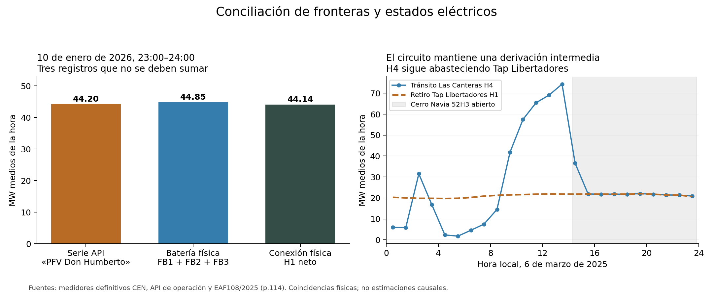

# Don Humberto y Las Canteras: conciliación física y estados efectivos

**Estado:** avance exploratorio para Energy Economics. Cierre SOCHER y bases originales preservados. Inicio de esta etapa: f757d7c. La hipótesis económica sigue abierta; esta entrega mejora su medición y contrasta explicaciones alternativas.

La asociación diurna de Las Canteras persiste en diciembre2025–febrero2026 después de incorporar Santiago Solar, la batería física y la conexión neta de Don Humberto. Se identifican dos problemas concretos en las series operativas que impedían tratarlas como componentes aditivos. Además, la maniobra del6mar2025 se concilia con los flujos: el circuito seguía abasteciendo una derivación intermedia.

## 1. Qué se recuperó y cómo se conciliaron las fuentes

Se consultó la API oficial para diciembre2025, enero2026 y febrero2026:180.274 registros BESS de todas las instalaciones,23 páginas incluyendo tres adicionales vacías. Se seleccionaron las llaves de Don Humberto16908(inyección),16909(retiro de central) y17487(retiro del sistema). Las70 repeticiones exactas se separan en el derivado. Hay2.160 horas calendario; faltan dos valores de inyección y uno de retiro de central. Las ausencias no se rellenan con cero. La comparación que necesita las tres series API utiliza87 días completos,2.088 horas.

En los tres ZIP definitivos ya descargados se localizaron **cinco medidores**, sin nuevas descargas masivas: FB1,FB2,FB3 y servicios auxiliares en33kV, y H1 en110kV. Se extrajeron43.200 registros de15min y se comprobaron los hashes de los ZIP antes y después. Los cinco canales cubren las2.160 horas completas. Se conservan D y R por separado, sus fechas locales y UTC; cuatro intervalos sumados en kWh/1.000 representan MWh de una hora y, numéricamente, MW medios horarios.

Las correspondencias con batería se apoyan en la conciliación cuantitativa; no se deducen únicamente del nombre del medidor. La coincidencia de dos publicaciones CEN no equivale a validación con un medidor independiente; por eso se incorpora esta segunda familia de datos físicos.

### Inyección y retiro no tienen la misma calidad

| Mes | Error relativo absoluto de inyección API frente a D de FB1–FB3 | Error al sumar retiros API frente a R de FB1–FB3 |
|---|---:|---:|
| Diciembre2025 | 0,277% | 16,519% |
| Enero2026 | 0,048% | 13,533% |
| Febrero2026 | 2,789% | 2,946% |

WAPE = suma de diferencias absolutas / suma de la **medición física** en las horas comparables. La tabla diagnóstica inicial de enero usa la API como denominador y obtiene12,485% para retiros; la diferencia de denominador está explícita, no es otro resultado físico.

En205 horas de los tres meses aparece un patrón específico: «retiro de central» coincide con el retiro físico total dentro de0,051MW, mientras «retiro del sistema» también es positivo y su suma sobrepasa el medidor. Ejemplo:23ene2026 a00:00, cada serie API informa26,21MW y la medición conjunta es26,214MW. Sumarlas produciría52,42MW. También hay horas con subregistro respecto al retiro físico. No se corrigen los archivos API ni se propone una partición central/sistema artificial; se utilizan los canales físicos separados en la nueva sensibilidad.

### El rótulo solar tampoco permite sumar componentes automáticamente

El10ene2026 a23:00, la API informa44,20MW como PFV; los tres canales físicos de batería inyectan44,851MW y H1 entrega44,144MW netos. El balance diario publicado en el[EAF008/2026](https://www.coordinador.cl/wp-content/uploads/2026/01/EAF-008-2026.pdf), páginas52,58 y64, reproduce las cuatro series API dentro del redondeo:96 valores contrastados, diferencia máxima0,05MW.

En enero hay17 horas nocturnas con PFV superior a0,1MW;16 corresponden a23:00. En esas17 horas, sumar PFV más inyección BESS menos retiros publicados excede H1 neto en promedio17,78MW. La diferencia H1 neto menos el neto de los tres FB es, en promedio,−0,384MW, compatible con diferencias de frontera, pérdidas y servicios auxiliares; **no se bautiza ese residuo como generación solar certificada**. Hay evidencia de mezcla/solapamiento entre registros, pero falta la explicación oficial de construcción de la serie PFV para corregirla de forma general.

## 2. Estados efectivos de la red

| Instalación y episodio | Inicio efectivo | Fin efectivo | Duración |
|---|---|---|---:|
| Cerro Navia52H3, SD2025023534 | 06mar2025 14:17 | 06mar2025 23:50 | 573min |
| Punta Peuco–Loma Los Colorados110kV, IF2026001051 | 11feb2026 12:15 | 11feb2026 13:55 | 100min |
| Central Loma Los Colorados2, salida con7MW previos | 11feb2026 12:15 | 11feb2026 14:45 | 150min |

La apertura de Cerro Navia se acredita en la tabla de fechas efectivas del[EAF108/2025](https://www.coordinador.cl/wp-content/uploads/2025/03/EAF-108-2025.pdf),p.114. La solicitud14:12 y el término programado18:00 son hitos distintos de ejecución14:17–23:50. El[informe diario11feb2026](https://www.coordinador.cl/wp-content/uploads/2026/02/Informe-Diario-11-02-2026.pdf),p.19, permite separar la normalización de la línea del retorno de la central. Los intervalos parciales se codifican como minutos y fracción de hora, no como desconexión de una hora completa.

**Se resuelve la aparente contradicción de H4.** El catálogo conecta Las Canteras H4 con Tap Libertadores H1. Durante las ocho horas íntegramente comprendidas en la apertura de Cerro Navia, H4 promedia21,7289MW y el retiro de Tap Libertadores H1,21,7301MW: error absoluto medio0,00537MW y WAPE0,0247%. Las Canteras HT1+HT2 consumen2,6653MW. El flujo de21,73MW corresponde al tramo que abastece la derivación; no debe asignarse al centro de datos ni esperarse que desaparezca por abrir el extremo distante. Esto corrige la interpretación provisional del informe anterior, sin modificar sus datos.

Sigue pendiente el intervalo efectivo completo de SD2025004130 del22ene2025. Se conoce la intervención y sus instrucciones; el inicio programado y los ceros de un medidor no sustituyen la acreditación del estado. Estos episodios no constituyen todavía un calendario exhaustivo de topología histórica. Las horas sin registro se mantienen como estado desconocido.

## 3. Qué sucede con la asociación de Las Canteras

Se conservan los cinco resultados zonales previos, los bloques10–16h y19–23h, FE de día, mes×hora y hora de la semana, y el retiro de Tap Libertadores como control de otra gran carga. El cuadro muestra la pendiente de Las Canteras durante10–16h para el diferencial de la zona respecto al comparador distante5. Unidad:(USD/MWh)/MW. Las especificaciones dentro de cada comparación usan exactamente las mismas horas.

| Ajuste, ventana física de90 días | Pendiente diurna | Intervalo aproximado95%, HAC semanal4 |
|---|---:|---:|
| Otra carga: Tap Libertadores | 2,833 | [0,204;5,461] |
| + Santiago Solar | 2,762 | [0,196;5,328] |
| + inyección y retiro físicos BESS | 2,760 | [0,169;5,351] |
| + neto físico de la conexión H1 | 2,774 | [0,275;5,273] |

La última especificación utiliza la frontera conjunta H1 además de ambos sentidos de la batería. No suma el rótulo PFV a la batería. Al excluir11feb, su pendiente es2,798. En las mismas87 fechas utilizadas por la API, los ajustes completos dan2,897 físico y2,895 con las series API: **la pequeña variación de coeficientes no valida las series API**; la conciliación física sigue mostrando sus problemas.

La comprobación post hoc de influencia mensual mantiene signo positivo:2,699 omitiendo diciembre;2,789 omitiendo enero;3,035 omitiendo febrero. Se publica completa y con su adenda fechada después de conocer2,774. Es evidencia de estabilidad dentro de esta ventana, no una selección del resultado más favorable.

**Lectura econométrica:** la batería y la conexión de Don Humberto, tal como se miden aquí, no absorben la asociación diurna observada. Es un indicio exploratorio compatible con nuestra hipótesis, que justifica continuar hacia identificación causal. Los intervalos normales aproximados excluyen cero en varias especificaciones, pero90 días aportan solo13 semanas y tres grupos mensuales; no sostienen por sí solos una afirmación causal. La diferencia entre pendiente diurna y resto es0,890, con intervalo[−0,186;1,967]: tampoco está establecida una respuesta exclusivamente diurna.

La variación de carga que queda después de los controles es reducida (desviación estándar0,145MW en el ajuste completo;0,049MW al excluir diciembre). El coeficiente «por MW» es una escala de presentación, no un experimento observado de añadir1MW. Generación, batería y precios se determinan conjuntamente; podrían ser respuestas al mismo estado del sistema o canales del efecto. La maniobra de una línea altera directamente los precios y no sirve automáticamente de instrumento para el consumo de Las Canteras.

El2,774 no reemplaza el0,55 del panel largo ni el1,05 de la réplica de primeras entradas: cambian la ventana y, en el último caso, la definición del tratamiento. Se publican todos por separado. La ventana de tres meses fue elegida por conciliación de datos y episodios, antes de observar sus nuevas pendientes, pero después de conocer las anomalías generales.

## 4. Qué falta para el paso causal

1. Extender la frontera física conciliada al panel largo y a etapas anteriores de operación; verificar si el patrón se mantiene fuera de estos tres meses.
2. Completar los estados efectivos, límites aplicables y otras cargas del corredor. La apertura parcial y una restricción sistémica son exposiciones distintas.
3. Buscar variación documentada del consumo del centro de datos que pueda separarse de precios, clima, despacho y maniobras, y examinar anticipaciones y comparadores. El criterio será la plausibilidad del contrafactual, no alcanzar un signo o un valorp.

Para Energy Economics, el avance concreto es pasar de etiquetas operativas potencialmente solapadas a fronteras medidas y maniobras verificadas. La señal merece estudio adicional; su atribución todavía requiere ese diseño.

## 5. Trazabilidad y reproducción

- [Protocolo inicial](PROTOCOLO_BESS_Y_ESTADOS_20261011.md), [ampliación contigua](ADENDA_BESS_VENTANA_20261011.md), [medición física](ADENDA_BESS_MEDICION_FISICA_20261011.md) y [sensibilidad mensual posterior](ADENDA_BESS_INFLUENCIA_MENSUAL_20261011.md).
- [Conciliación y estados](resultados/20261011_bess_conciliacion_v2/), [comparación API](resultados/20261011_estimacion_bess_v1/), [comparación física](resultados/20261011_bess_fisico_v1/) y [dependencia mensual](resultados/20261011_bess_influencia_meses/).
- [Bitácora](BITACORA.md), [control de cambios](CONTROL_CAMBIOS.csv) y [reproducción](REPRODUCCION.md).

Se reprodujeron650 contrastes (200API,300 físicos,150 de influencia mensual), con diferencia numérica máxima inferior a1e−8, y se verificaron cuatro sistemas de coeficientes mediante dummies explícitas y LSQR independiente. Los271 insumos protegidos y los archivos históricos SOCHER siguen sin cambios. Las correcciones de lectura decimal y de soporte incompleto se conservan en el historial; ninguna modifica fuentes originales.
