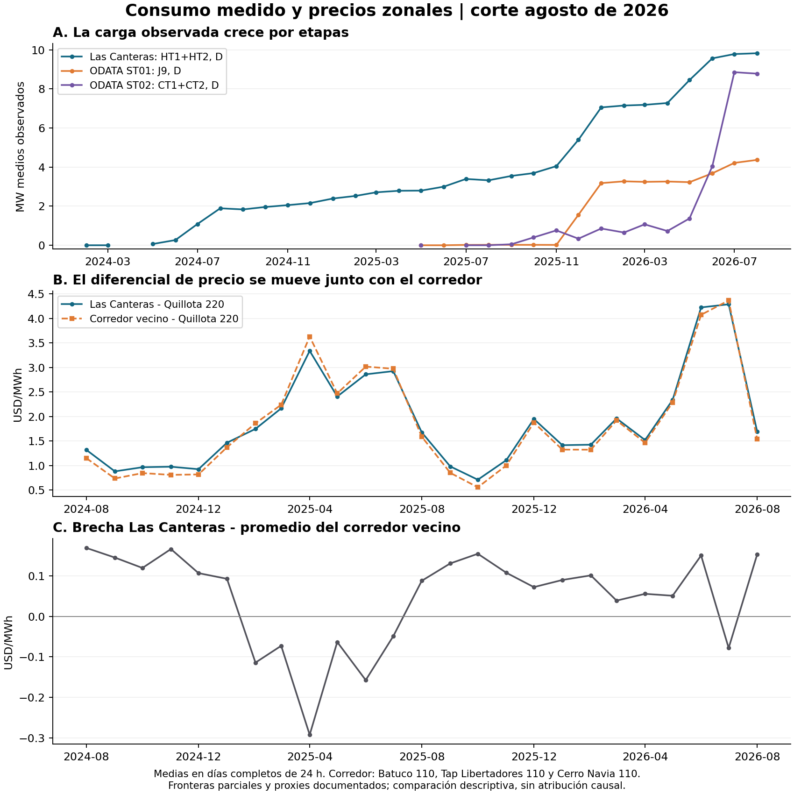

# Las Canteras y ODATA: conciliación y primeros indicios zonales

**Corte de datos: agosto de 2026. Revisión: 11 de octubre de 2026.**

## Qué se logró

Se concilió carga física con retiros comerciales, se separaron rutas de suministro y se preparó un panel mensual de carga y precios. **Las Canteras ya tiene una medida de exposición con fuerte respaldo empírico. ODATA ST01 ofrece un segundo caso aprovechable desde 2026; ST02 muestra una transición que exige distinguir conexiones y componentes comerciales.**

También apareció una señal económica: el diferencial Canteras–Quillota aumenta con la carga en las cuatro especificaciones exploratorias previstas. La señal es, en gran medida, compartida por el corredor vecino. Esto apoya estudiar exposición zonal; para atribuirla a centros de datos aún hay que separar cambios de carga de cambios comunes de la red y de otras demandas.

La réplica histórica y sus resultados se conservaron. Estas cifras responden a otro objeto: dosis medida en conexiones, no primera entrada por distrito. Todos los resultados siguientes se guardaron en nuevas carpetas.

## 1. Conciliación física y comercial

La comparación principal conserva las etiquetas locales y exige días civiles de 24 horas, datos completos en ambas fuentes y claves comerciales no ambiguas. No convierte los días muestreados en consumo mensual. Se contrastaron también etiquetas UTC y desplazamientos de una hora sin elegir un reloj por el mejor encaje.

| Medición física / cliente comercial | Días completos comparables | Diferencia acumulada física–comercial | Error absoluto diario relativo | Lectura |
|---|---:|---:|---:|---|
| Canteras HT1+HT2 D / EdgeConneX CANTERAS_110 | **60** | **−0,32 %** | **0,44 %** | Correspondencia fuerte en septiembre 2024–julio 2026. |
| Nueva Lampa J9 D / ODATA LAMPA_220 | **18** | **−1,16 %** | **1,21 %** | Correspondencia fuerte, con discrepancias concentradas en junio 2026. |
| ODATA ST02 CT1+CT2 D / LO_ESPEJO_110 | **1** | **−0,34 %** | **0,34 %** | Buena coincidencia puntual; muestra principal insuficiente para certificar estabilidad. |
| J9 D / ODATA BATUCO_013 | 16 | −99,48 % | 99,48 % | No representan la misma carga en las fechas solapadas. |
| ST02 CT1+CT2 D / PANAMERICANA_012 | 19 | −83,12 % | 83,12 % | No representa el suministro completo previo del campus. |

El error absoluto diario relativo es la suma de las diferencias absolutas de energía de cada día, dividida por la energía comercial acumulada. La diferencia acumulada permite cancelación de signos; el error absoluto no. Son diagnósticos de concordancia, no precisión certificada de medidores.

En Canteras, 48 de 60 días difieren menos del 1 % y todos menos del 5 %. El error absoluto horario es 0,59 % para las 1.440 parejas válidas; al desplazar una hora aumenta a aproximadamente 1,02–1,07 %. La concordancia favorece la hipótesis de etiquetas locales, pero todavía debe documentarse la convención física inicio/fin del intervalo.

En ST01, 15 de 18 días quedan dentro del 1 %. Las diferencias de J9 frente a SIP son −9,10 %, −5,86 % y −3,51 % los días 5, 15 y 25 de junio de 2026. Se retienen y señalan para revisar estimaciones/revisiones comerciales, configuración y frontera; no se eliminan por empeorar el resultado. No se ha determinado su causa.

Archivos: [resumen de conciliación](resultados/20261011_conciliacion_v2/resumen_conciliacion.csv), [detalle diario](resultados/20261011_conciliacion_v2/conciliacion_diaria.csv), [sensibilidad al reloj](resultados/20261011_conciliacion_v2/sensibilidad_reloj.csv).

## 2. Qué cambió en la lectura de ODATA

**ST01 tiene carga previa y una conexión posterior que se activa gradualmente.** Mientras los días muestreados de Batuco muestran retiro de ODATA durante 2025, J9 registra cero en mayo–junio y aproximadamente 0,02 MW durante julio–noviembre. J9 sube a **1,56 MW en diciembre de 2025**, **3,18 MW en enero de 2026** y **4,37 MW en agosto de 2026**. Desde febrero de 2026, las mediciones físicas concuerdan con el retiro comercial valorado en Lampa220. Esto documenta una transición de exposición que la inauguración de 2022 no representa. No permite cuantificar todavía cuánto es traslado y cuánto expansión neta.

J9, JT5 y ET5 no son tres cargas. El plano une J9 con el futuro JT5/T5. En julio de 2026 registran, respectivamente, **3.136,21; 3.140,13 y 3.129,92 MWh**. Su cercanía respalda examinarlos como puntos de una misma ruta, no sumarlos. La diferencia de canales no se denomina automáticamente pérdida técnica; queda pendiente la polaridad histórica y configuración de JT5.

**ST02 también necesita separar suministro previo y nuevo.** CT1+CT2 registra aproximadamente **1,37 MW en mayo de 2026**, **4,04 MW en junio** y **8,86 MW en julio**. El registro comercial previo Panamericana012 es mucho mayor que esos CT durante buena parte de 2025–2026. A partir de julio aparece Lo Espejo110 y concuerda con la nueva frontera. Las series no deben empalmarse suponiendo que siempre midieron el mismo perímetro.

El balance físico de julio aporta evidencia adicional: Panamericana H3+H4 D suma **6.618,41 MWh**, HT1+HT2 R **6.619,50 MWh** y CT1+CT2 D **6.590,51 MWh**. Los extremos de línea/alta tensión prácticamente coinciden; CT se sitúa ligeramente por debajo. Es coherente con la ruta documentada y refuerza que los canales representan etapas sucesivas de medición. No se suman entre sí ni se invierte el rótulo de HT por conveniencia.

Fuentes numéricas: [carga mensual sobre días completos](resultados/20261011_conciliacion_v2/carga_mensual_dias_24h.csv), [balances de canales](resultados/20261011_conciliacion_v2/balances_canales_mensuales.csv), [SIP: medias de días muestreados](resultados/20261011_diagnosticos_adicionales_v1/SIP_medias_dias_muestra_por_mes.csv).

### Dos días comerciales de ST02 que pueden recuperarse, condicionalmente

Se revisaron los originales de julio: el 5 contiene una cantidad por hora; el 15 y el 25 contienen dos cantidades diferentes con la misma clave comercial. La base anterior las marcó ambiguas y así permanece.

La hipótesis de dos componentes concuerda con CT1/CT2 tanto en la suma como en las cantidades ordenadas. Los errores absolutos horarios relativos de los días 15 y 25 son **0,35 % y 0,30 %**. La evidencia sugiere desagregación por componentes de suministro, en vez de una duplicación del mismo valor. Sin identificador de medidor/componente no se certifica esa interpretación.

Se guardó una alternativa con los tres días, claramente condicional, junto con las filas originales. No se sustituyó el valor faltante del panel principal ni se declaró resuelta la ambigüedad comercial. Esta comprobación se añadió después del resultado inicial y consta en la [adenda exploratoria](ADENDA_DIAGNOSTICOS_20261011.md). [Resultados de la alternativa](resultados/20261011_diagnosticos_adicionales_v1/ST02_alternativa_condicional_resumen.csv).

## 3. Conexiones: qué está respaldado y qué sigue pendiente

| Caso | Conexión respaldada | Consecuencia para estimar |
|---|---|---|
| Canteras | Homologación oficial CANTERAS110 con BP1 de S/E Las Canteras. HT1/HT2 vinculados a transformadores distintos y NUP3975. Carta declara energización de paños el 29-05-2024. | Se puede usar carga HT1+HT2 como exposición parcial en esa instalación. Falta historia de acoplamiento BP1/BP2 y otras fases; no asignar HT3 a esta frontera. |
| ST01 | Plano J9 Nueva Lampa → JT5/T5 Lampa; catálogo ODATA en J9/JT5/ET5 y concordancia comercial en Lampa220 desde febrero 2026. | La nueva conexión tiene medición aprovechable. El empalme de distribución de 2022 y la transición efectiva siguen pendientes. Lampa220 es referencia candidata; falta cerrar barra principal/estado de acoplamientos de T5. |
| ST02 | Catálogo ODATA San Bernardo identifica H3/H4 Panamericana, HL/HT y CT; carta vincula NUP3129 con Lo Espejo Data Center. | El balance físico respalda la ruta. Lo Espejo110 es punto de valorización comercial, no se ha demostrado que sea la misma barra física de Panamericana110. |

**Dos precisiones nuevas para el diseño:**

- La ficha de transformador `3652`, rotulada **Lampa JT4**, registra entrada validada el **06-07-2025**. El informe diario menciona ET5 y un equipo de 60 MVA, mientras el plano de la conexión ODATA menciona **T5**. No se asigna el 6 de julio al T5 de ODATA sin resolver esa identidad. Una obra de red coincidente debe permanecer separada de la carga del centro.
- En los archivos modernos revisados, **NVALAMPA_220 aparece desde septiembre de 2025** y **PANAMERICANA_110 solo desde agosto de 2026**. Ausencia de precio publicado no significa ausencia de conexión. No se rellena el pre con otra barra de distinto nivel de tensión.

Fuentes archivadas: [mapeo oficial de Canteras](../SOCHER_2026_v3/mapeo/Memo_mapeo_electrico_y_unidades.md), [documentación de ST01](../SOCHER_2026_v8_panel_causal/investigacion_odata_20260927/medicion/README_medicion_conexion.md), [revisión de conexiones y fuentes de esta etapa](CONEXIONES_CONCILIACION_20261011.csv). Los documentos primarios se identifican con página/localizador y huella en la tabla de evidencia; no se descargaron nuevas versiones.

## 4. El indicio económico que encontramos

Con **25 meses, agosto de 2024–agosto de 2026**, se relaciona la carga física HT1+HT2 con el precio mensual de Canteras y con su diferencial respecto de Quillota220, usando días completos comunes. Es una exploración de intensidad posterior a la expansión, no un antes/después causal de entrada.

| Especificación registrada | Meses | Asociación carga–diferencial D, USD/MWh por MW |
|---|---:|---:|
| Niveles | 25 | **+0,165** |
| Con tendencia lineal | 25 | **+0,193** |
| Primeras diferencias | 24 | **+0,691** |
| Diferencias interanuales | 13 | **+0,083** |

La correlación en niveles es **0,46**. Al excluir un mes por vez, el coeficiente en niveles permanece positivo y varía entre **+0,112 y +0,203**. Esta última prueba es exploratoria posterior, declarada en la adenda. Los tamaños varían y las muestras son pequeñas; no se informa significancia causal. El precio total P ofrece un patrón menos estable: su asociación interanual es negativa. Se conserva esa diferencia de resultados, sin elegir únicamente la variable favorable.

**La localización de la señal importa.** Para los mismos días, el corredor compuesto por Batuco110, Tap Libertadores110 y Cerro Navia110 también presenta una asociación positiva frente a Quillota: **+0,161 USD/MWh por MW** en niveles. La brecha Canteras–promedio de ese corredor tiene una asociación de solo **+0,005** en niveles. Las barras vecinas se mueven juntas y no son controles independientes. Tampoco esta semejanza demuestra que el centro cause el movimiento del corredor.

La señal es compatible con una presión zonal compartida; también puede reflejar generación, hidrología, combustibles, otras cargas u obras que evolucionaron junto al retiro digital. La prueba causal siguiente debe distinguir estas explicaciones. Es un indicio empírico que justifica la investigación del mecanismo, no una nueva cifra de impacto atribuible ni una extrapolación a 2030.

El +0,165 es una pendiente de asociación por MW medido. El +1,05 de la réplica era un contraste de entrada por distrito, en USD/MWh. No son el mismo estimando y no se comparan como si uno corrigiera al otro.

[Todos los diagnósticos registrados](resultados/20261011_conciliacion_v2/diagnostico_canteras_carga_precio.csv), [sensibilidad espacial](resultados/20261011_diagnosticos_adicionales_v1/sensibilidad_espacial.csv), [exclusión de meses](resultados/20261011_diagnosticos_adicionales_v1/exclusion_mes_canteras.csv).

## 5. Panel preparado y siguiente paso de identificación

Se generaron series horarias/diarias de fronteras, conciliaciones, precios diarios para nodos candidatos y un [panel mensual exploratorio](resultados/20261011_conciliacion_v2/panel_zonal_mensual_exploratorio.csv). Cada pareja carga–precio conserva la calidad de su enlace; los proxies ODATA no se presentan como empalmes certificados. Los intervalos de 15 minutos y múltiples medidores no crean más tratamientos independientes.

El orden de avance que resulta de esta revisión es:

1. **Las Canteras como primer estudio de intensidad zonal.** Usar HT1+HT2; construir exposición del corredor y una comparación externa justificada por red y evolución previa. Las barras vecinas actuales quedan como parte del resultado zonal, no como controles no expuestos. Incorporar cronología de ampliaciones, generación y otras grandes cargas. La carga por sí sola es endógena: hace falta justificar qué variación permitiría atribución.
2. **ST01 como estudio de transición de suministro y expansión.** Obtener continuidad comercial de diciembre 2025–enero 2026, el acta de transferencia/empalme y explicar junio de 2026. Separar carga trasladada de incremento neto. Los ceros de J9 en 2025 son del nuevo punto, no del centro entero.
3. **ST02 como contraste de nueva alimentación.** Aclarar identificadores de las dos componentes comerciales y obtener el esquema vigente de conexión con barra de precio. El salto de junio–julio de 2026 es un candidato operacional observable, pero confluyen traslado y expansión y la serie posterior es corta.

La solicitud documental queda ahora mucho más acotada: fronteras/medidores, vigencia de conexiones y claves comerciales concretas, no nuevas descargas generales. El análisis causal puede avanzar a partir de esta medición; su identificación aún no está cerrada.

## Preservación y reproducibilidad

No se modificaron bases originales ni resultados de la réplica. La conciliación principal verificó **33 insumos** antes/después; los diagnósticos adicionales verificaron **11**. El día 15-10-2024 de Canteras reprodujo independientemente las cifras archivadas en la auditoría anterior. La [bitácora](BITACORA.md), el [control de cambios](CONTROL_CAMBIOS.csv), el [protocolo](PROTOCOLO_CONCILIACION_20261011.md) y la [adenda](ADENDA_DIAGNOSTICOS_20261011.md) distinguen decisiones iniciales y exploraciones posteriores. Se mantiene el control previo de 271 insumos de disponibilidad.

No hubo nuevas descargas ni contactos con terceros. Los originales externos siguen siendo necesarios para reproducir esta etapa completa.
