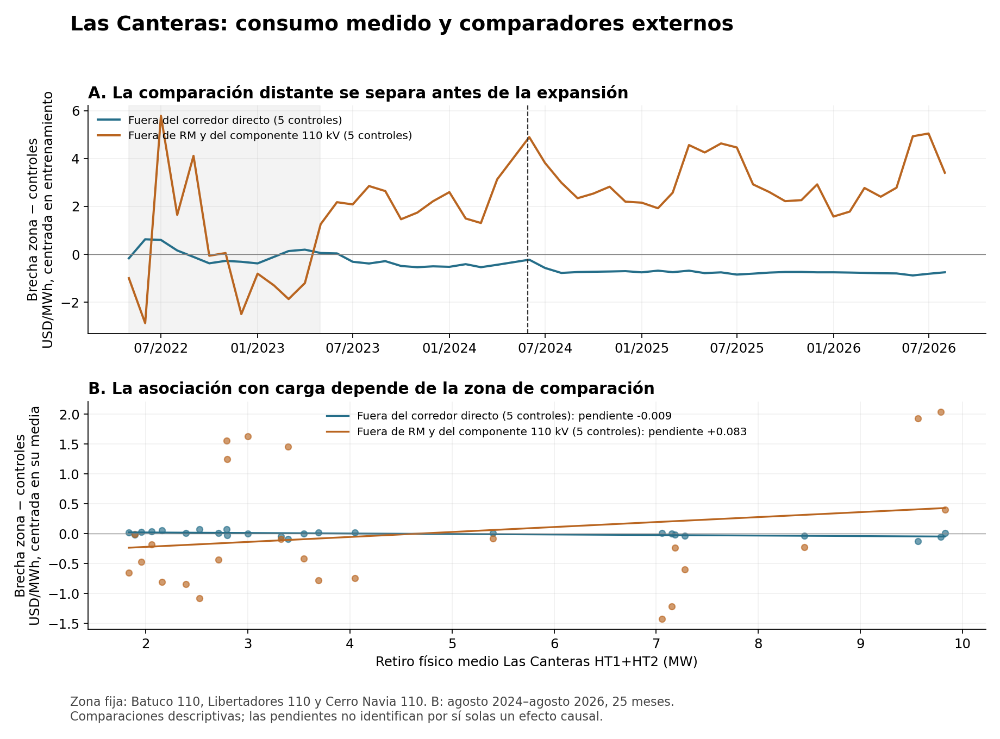

# Las Canteras y sus comparadores eléctricos externos

**La carga física permite estimar una relación zonal, y la comparación distante conserva una asociación positiva. Su atribución a Las Canteras sigue abierta porque los comparadores ya divergían antes y otras cargas crecieron simultáneamente.** Ahora se conoce cuánto depende el resultado de la cercanía eléctrica de los controles, de las obras y del tratamiento de esas cargas.

Revisión del 11 de octubre de 2026. Este informe amplía la [conciliación física y comercial](INFORME_CONCILIACION_20261011.md) y conserva el cierre SOCHER v0.3.0. La tabla de disponibilidad solicitada está publicada en la [portada de GitHub](https://github.com/a-cartes/datacenter#datos-efectivamente-encontrados-y-revisados), commit `779b97c`.

## 1. Qué se estimó

La exposición es el retiro físico de **HT1+HT2 de Las Canteras**, conciliado previamente con EdgeConneX en 60 días comerciales completos (error absoluto diario ponderado 0,44%). Excluye HT3 y los tránsitos de línea. Se investiga una rampa de utilización de esa frontera; no se supone que todo sea demanda nueva neta del campus o del sistema.

La zona de precios mantiene tres barras, con pesos iguales: **Batuco 110 kV, Tap Libertadores 110 kV y Cerro Navia 110 kV**. Su composición estaba definida antes de esta búsqueda. Canteras 110 kV es un resultado secundario porque su serie propia no tiene 24 meses previos. Se restan precios de comparadores; Quillota se cancela exactamente al comparar dos diferenciales D.

Hay dos ejercicios separados:

- **Contraste de la expansión histórica:** 24 meses previos, mayo de 2022–abril de 2024, frente a 27 meses posteriores, junio de 2024–agosto de 2026. Mayo de 2024 se excluye como transición. Es una comparación de la expansión conjunta de conexión, carga y red.
- **Relación con intensidad física:** 25 meses, agosto de 2024–agosto de 2026, con precios del mismo régimen y días de 24 horas completos comunes a carga y barras. El coeficiente se expresa en **USD/MWh por MW de retiro medio**, distinto del efecto binario histórico de 1,05 USD/MWh.

Las reglas están en el [protocolo](PROTOCOLO_CONTROLES_EXTERNOS_20261011.md). La comparación más distante se añadió después de examinar la primera, y queda identificada como exploratoria en la [adenda](ADENDA_CONTROLES_DISTANTES_20261011.md).

## 2. Búsqueda y selección de controles

Se revisaron barras de 110 kV en Metropolitana, Valparaíso y O'Higgins–Maule, con identidad por homologación. Se excluyeron nodos directos o del corredor de otros centros según la unión de dos mapas de exposición, puntos con retiros DC registrados y series sin cobertura completa. Se mantuvo una barra por subestación. La exclusión usa información de exposición conocida al cierre y la cobertura posterior: no es una selección ciega ni acredita ausencia de todos los datacenters.

Entre 84 candidatos elegibles, el orden se fijó por semejanza de las trayectorias previas centradas, usando solo mayo de 2022–abril de 2023. Los doce meses siguientes se reservaron para validación. Se usaron medias con pesos iguales, sin escoger por signo posterior.

| Conjunto | Comparadores principales | Alcance eléctrico |
|---|---|---|
| Externos al corredor directo, K5 | Pajaritos, San José, San Pablo, Punta Peuco 110 kV y Altamirano | Varios comparten abastecimiento a través de Cerro Navia; pueden captar parte de la misma perturbación regional. |
| Fuera de RM y del componente de 110 kV, K5 | San Rafael, Leyda, San Antonio, Quelentaro y La Estrella | No pertenecen al componente de 110 kV de Las Canteras reconstruido en el catálogo; permanecen conectados al sistema mediante otras tensiones. |
| Sensibilidad distante, K7 | Los cinco anteriores, más Portezuelo y Cerro Calera | Todos los candidatos que cumplen el filtro más restrictivo. |

El filtro distante completa kV ausente cuando el nombre del tramo declara explícitamente la tensión. No es una red histórica certificada ni una prueba de independencia eléctrica. Se conservaron todos los [candidatos y rechazos iniciales](resultados/20261011_controles_externos_v1/candidatos_y_exclusiones.csv), el [ranking distante](resultados/20261011_controles_distantes_v1/ranking_previo.csv) y el [componente de 110 kV](resultados/20261011_controles_distantes_v1/componente110_canteras.csv).

## 3. Resultados de la intensidad medida

Cada celda es una pendiente en USD/MWh por MW de retiro medio HT1+HT2. Las especificaciones y signos se conservan completos.

| Especificación | Zona frente a externos directos K5 | Zona frente a distantes K5 | Zona frente a distantes K7 |
|---|---:|---:|---:|
| Niveles, 25 meses | −0,0087 | **+0,0830** | **+0,1031** |
| Con tendencia lineal | −0,0066 | +0,0653 | +0,1054 |
| Primeras diferencias, 24 cambios | −0,0272 | +0,3085 | +0,3618 |
| Diferencias de 12 meses, 13 cambios | +0,0004 | +0,0174 | +0,0523 |
| Tendencia e indicadores de tres obras | −0,0114 | +0,0973 | +0,1364 |

La estimación en niveles con cinco controles distantes tiene intervalo 95% HAC3 **[−0,1203;0,2864]**; con siete, **[−0,1137;0,3198]**. Son intervalos condicionales al modelo, no intervalos de un efecto causal identificado. Con 25 meses, y especialmente con 13 diferencias anuales solapadas, la aproximación de inferencia es limitada; HAC3 no elimina automáticamente la dependencia de esas diferencias.

Para el precio de **Canteras 110 kV**, frente a los mismos controles distantes, las pendientes en niveles son **+0,0880** y **+0,1080**, respectivamente. Con diez comparadores del conjunto inicial, la pendiente de la zona es +0,0083: el signo también depende de la composición dentro de ese conjunto.

La señal positiva distante no depende de un solo comparador: excluyendo uno a la vez, la pendiente zonal con K5 queda entre **+0,0737 y +0,0904**; con K7, entre **+0,0843 y +0,1113**. Esta comprobación de influencia se hizo después del resultado principal y está separada en la verificación.

Hay, sin embargo, una sensibilidad grande al tratamiento de la red: si además de indicadores y tendencia se excluyen los meses de entrada de las tres obras, la pendiente distante K5 sube a **+0,8039**, con 22 meses. La inflación de varianza de la carga pasa de 18,0 a 31,7 frente a las demás variables. Ese salto se informa como **inestabilidad del ajuste**, sin privilegiar la especificación porque tenga un intervalo positivo.

Tablas completas: [externos directos](resultados/20261011_controles_externos_v1/estimaciones_mensuales.csv), [distantes](resultados/20261011_controles_distantes_v1/estimaciones_mensuales.csv), [sensibilidad por control](resultados/20261011_controles_distantes_v1/sensibilidad_control_individual.csv).

## 4. La validación previa es el obstáculo concreto

| Comparación zonal | Cambio posterior menos previo, USD/MWh | Cambio dentro del previo: validación menos entrenamiento | RMSE de validación previa |
|---|---:|---:|---:|
| Externos directos K5 | −0,554 | −0,360 | 0,411 |
| Distantes K5 | +2,063 | **+2,081** | 2,168 |
| Distantes K7 | +2,731 | **+3,132** | 3,237 |

Los contrastes de las dos primeras columnas usan ventanas diferentes; no son cantidades que deban restarse para obtener un efecto “corregido”. Su comparación muestra que la separación frente a las zonas distantes es del mismo orden **antes** de mayo de 2024. Excluir julio de 2024 apenas cambia los contrastes distantes (+2,036 y +2,703), por lo que ese mes no explica toda la fragilidad.

La evidencia actual plantea un intercambio: las barras cercanas se parecen más, pero pueden compartir el efecto; las distantes reducen esa exposición directa, pero traen otras dinámicas. Ninguno de los grupos queda certificado como contrafactual causal. La asociación positiva apoya seguir contrastando el mecanismo; no permite adjudicarle todavía una magnitud causal a Las Canteras, ni concluir ausencia de efecto sistémico.

En A, la franja gris corresponde al entrenamiento y la línea discontinua al 29-05-2024. La curva usa medias mensuales y excluye mayo de 2024. En B, cada punto representa un mes del panel físico común.

## 5. Otras cargas que ya entraron en la estimación

Se cruzaron **61 días muestreados completos**, repartidos en 22 meses, con retiros comerciales no ambiguos de Google en Libertadores y Ascenty en Chacabuco 13 kV y 23 kV. Carga física y precios se promedian sobre esos mismos días. No se extrapolan tres días al consumo mensual ni se suman registros ambiguos.

| Punto observado | Agosto de 2024, MW medios de 3 días | Julio de 2026, MW medios de 3 días |
|---|---:|---:|
| Las Canteras HT1+HT2, físico | 2,283 | 9,758 |
| Google–Libertadores, comercial | 26,328 | 34,868 |
| Ascenty–Chacabuco 13 kV, comercial | 2,737 | 4,398 |
| Ascenty–Chacabuco 23 kV, comercial | 0,824 | 3,132 |

Estas cifras describen puntos de suministro, no censos completos por operador. En la muestra conjunta la correlación del retiro de Las Canteras con los tres puntos es 0,70, 0,77 y 0,90. Crecen juntos y es difícil separar sus contribuciones solo con esas trayectorias.

Con controles distantes K5, la pendiente zonal sobre los 61 días pasa de **+0,1498** a **+0,2075** al introducir los tres retiros, y a **+0,3834** al añadir tendencia. Los intervalos respectivos siguen incluyendo cero; para +0,2075 son [−0,4996;0,9147]. Con efectos fijos de mes sube a +1,6047, pero la inflación de varianza de Las Canteras alcanza 116 y se estiman 26 parámetros con 61 días: ese ajuste tiene escasa variación independiente disponible. No se elige como resultado principal.

Se revisó también la historia física de Chacabuco: 24 puntos con cobertura desigual, cambios de identificador y canales D/R separados. Se guardó una [comparación de semestres y cobertura](resultados/20261011_verificacion_zonal_v1/canales_chacabuco_semestres_comparables.csv), sin sumar tránsito ni restar automáticamente cargas comerciales. **Todavía no hay una serie homogénea de demanda no-DC del corredor**. Tampoco un control separado del despacho de Santiago Solar, Renca y las restricciones operativas horarias. Los retiros comerciales incluidos no resuelven esas omisiones.

Datos y estimaciones: [muestra común](resultados/20261011_controles_distantes_v1/panel_dias_con_otras_cargas.csv), [modelos de cargas concurrentes](resultados/20261011_controles_distantes_v1/estimaciones_otras_cargas.csv).

## 6. Cambios de red revisados

Se contrastaron el inventario anterior, las fichas técnicas disponibles, el catálogo de aristas y el extracto del Estudio de Continuidad de Suministro 2025 del Coordinador. Fechas y objetos se mantienen separados.

| Obra o antecedente | Fecha y calidad encontrada | Consecuencia para el diseño |
|---|---|---|
| Nuevo transformador Chacabuco | EO 23-01-2024, ECS2025 | Cambio en zona de otras cargas antes de la expansión de Canteras. |
| Cambio de trazado Polpaico–El Salto220 | EO 29-04-2024, ECS2025 | Coincide con la frontera entre previo y posterior. |
| Seccionadora Colina/Las Canteras | EO 02-05-2024, ECS2025 | Se modifica la red a la vez que se habilita demanda. |
| Canteras HT1 y HT2 |29-05-2024, ficha técnica validada y carta ya revisada | Hito de equipos; no apertura inicial de todo el campus. |
| Chacabuco, traslado transformador4 a posición5 | EO 29-07-2024, ECS2025 | Cambio de configuración y posibles rótulos de medición. |
| Canteras HT3 |19-08-2024, ficha validada; ECS indica19-10-2024 | Discrepancia conservada. HT3 sigue fuera de la frontera principal. |
| Nueva Renca, reemplazo transformador de potencia TG | EO 17-12-2024, ECS2025 | Cambio del lado de generación próximo a comparadores del conjunto inicial. No se verificó su efecto sobre despacho. |
| Batuco HT4 |30-05-2025, ficha validada | Indicador desde junio de 2025; no equivale a choque de demanda exógeno. |
| Lampa JT4 |06-07-2025, ficha validada | Indicador desde agosto de 2025; no se confunde con T5 ODATA. |
| Lampa JT6 |26-01-2026, inventario/ficha tabular de transformador3d 597 | Indicador desde febrero de 2026. La asociación nominal con JT6 se mantiene como antecedente del inventario; la ficha tabular no tiene nombre. |
| Don Humberto–Punta Peuco industrial |07-11-2024, fecha mínima del catálogo | Afecta a un comparador inicial; no se considera una EO certificada. |
| Alto Melipilla–Leyda/San Antonio |12-08-2022, catálogo; obra troncal documentada ese día | Cambios durante el entrenamiento de comparadores distantes. |
| Santo Domingo–Leyda |28-08-2025, fecha mínima del catálogo | Cambio posterior en un comparador distante; pendiente acta operativa. |

Una obra construida para atender carga puede ser parte del mecanismo económico. Añadirla a una regresión no garantiza quitar sesgo: puede cambiar el efecto que se está intentando medir. Los tres indicadores se usan como diagnóstico de sensibilidad, no como identificación independiente.

Fuentes archivadas: [fechas de fichas técnicas](resultados/20261011_verificacion_zonal_v1/fechas_tecnicas_transformadores.csv), [extracto ECS2025](resultados/20261011_verificacion_zonal_v1/ECS2025_pp76_77_extracto.txt), [aristas de los comparadores distantes](resultados/20261011_controles_distantes_v1/aristas_fechadas_2022_2026.csv). El estado de certificación y la fecha de modificación del catálogo no se sustituyen por una supuesta fecha de operación.

## 7. Qué cambió respecto de los intentos anteriores

La asociación de D con carga en Canteras antes de usar controles era +0,1655; el corredor compartía +0,1605. Ahora se observa que la respuesta relativa depende de hasta dónde se extienda el comparador. Esa es información nueva sobre el alcance espacial de la señal.

Se encontró además un análisis nacional anterior: su contraste EDGE2024 de+6,518 agrupaba seis subestaciones y varias tensiones. En su propio desglose, Punta Peuco 23 kV aporta +76,114 con peso 1/6, mientras las otras unidades aportan valores negativos frente a aquel sintético. Se conserva como antecedente, sin mezclarlo con la presente zona fija ni ofrecerlo como confirmación independiente. Punta Peuco 23 kV y Punta Peuco 110 kV industrial tienen asignaciones distintas en los catálogos; el parecido de sus nombres no permite unirlos.

## 8. Qué deja preparado esta revisión

La medición de Las Canteras está conciliada, el panel de intensidad existe y la selección de controles externos es reproducible. Hay una asociación positiva frente a zonas distantes que sobrevive a excluir individualmente sus controles, pero su contrafactual previo no está validado. El avance hacia causalidad requiere resolver tres brechas concretas:

1. **Cerrar la demanda zonal neta:** reconstruir fronteras y cambios de configuración para distinguir nueva carga, traslados y otros consumos. Empezar por los puntos ya disponibles de Chacabuco y las rutas iniciales de EdgeConneX/ODATA.
2. **Cerrar la operación de red:** contrastar fechas y restricciones efectivas, incluidos el entorno de generación y las obras de los comparadores. El catálogo estático solo permite filtrar candidatos.
3. **Identificar variación independiente:** evaluar rampas o interrupciones de retiro documentadas y su causa, antes de usarlas como eventos o instrumentos. Una fecha técnica o un cambio de consumo no es automáticamente exógeno. La simulación de red puede aportar un contrafactual estructural separado de esta estimación observacional.

El resultado publicable hoy es la relación medida y su sensibilidad espacial y operativa. La hipótesis causal permanece abierta con datos y obstáculos específicos, sin convertir falta de identificación en evidencia de efecto nulo.

## Preservación y reproducción

Las dos ejecuciones comprobaron 38 y 39 insumos antes/después. La verificación independiente revisó 46 insumos y superó 12 comprobaciones, incluidas pendientes por covarianza/varianza, cancelación de Quillota y soporte común. La reproducción pública adicional confirmó **80 regresiones y sus errores HAC**, mediante una implementación independiente con NumPy (diferencias máximas inferiores a 1×10⁻¹²). La auditoría de preservación de 271 insumos y el tag v0.3.0 siguen intactos. Los 653 originales voluminosos no se reescribieron ni se afirma haber vuelto a calcular todos sus hashes.

Todos los resultados, positivos y negativos, quedan en carpetas nuevas. El [control de cambios](CONTROL_CAMBIOS.csv), la [bitácora](BITACORA.md) y la [reproducción](REPRODUCCION.md) documentan la selección inicial, la adenda distante y las comprobaciones posteriores. No se modificó el manuscrito SOCHER ni se sustituyeron sus coeficientes históricos.
