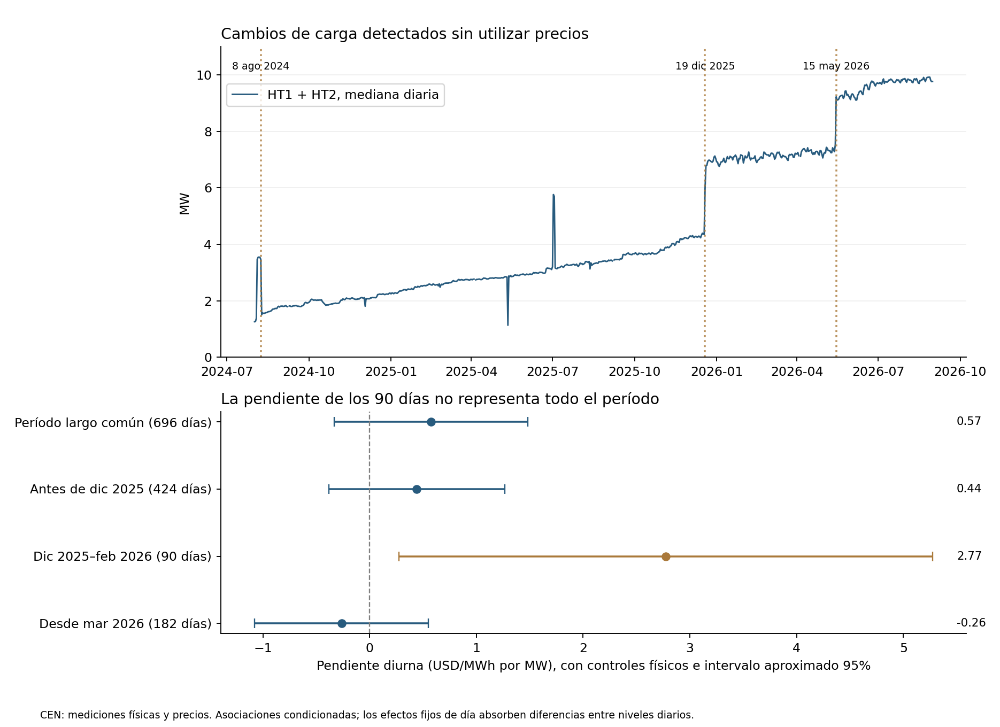
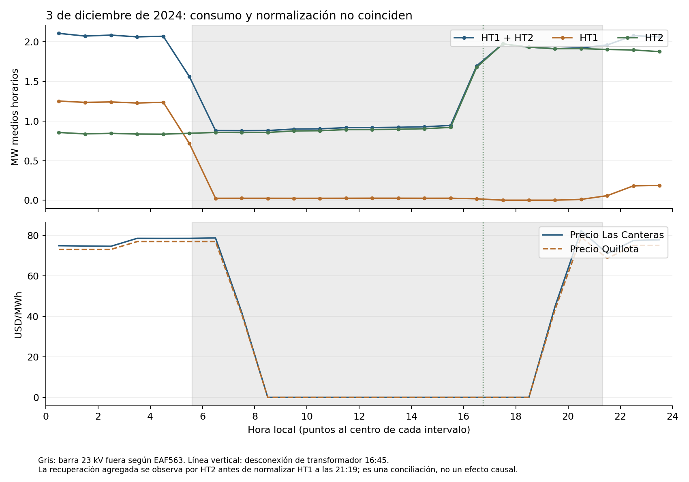

# Período largo y variaciones de carga de Las Canteras

**Avance para Energy Economics.** Versión de partida: `465c236`. Se extiende la conciliación a 25 meses y se identifica una interrupción local accidental documentada que merece evaluación como fuente de variación externa de carga. La asociación positiva de los 90 días previos no es representativa de toda la muestra. Se preservan los resultados anteriores, los originales y el cierre SOCHER.

## 1. La medición física ya cubre el período largo

Se seleccionaron los ZIP definitivos de 15 min de agosto 2024 a agosto 2026, uno por mes. Veintitrés estaban en la descarga inicial; los dos últimos se localizaron en `originales_descargados` de la etapa v7 y sus hashes coinciden con los manifiestos anteriores. No fue necesario descargar nuevamente los archivos masivos. Se reutilizaron las tres selecciones previamente conciliadas.

El derivado contiene **359.428 registros de 15 min y 18.264 horas físicas**. Las cinco series corresponden a Don Humberto: tres canales de batería, servicios auxiliares y conexión H1. En agosto y septiembre 2024 no aparece FB1; esa ausencia no se convierte en cero ni se interpreta como batería fuera de servicio. No se detectaron discordancias entre UTC y hora local. Se conservan horas de cambio de horario y cada sentido de energía por separado.

La unión con el panel anterior permite:

- **18.144 horas, 756 días:** conexión H1 disponible en el soporte común de precios y Santiago Solar.
- **16.704 horas, 696 días:** los tres canales de batería y H1 disponibles; octubre 2024–agosto 2026, excluyendo días incompletos según la regla anterior.
- La reconstrucción reproduce los 90 días previos con discrepancia máxima 7,1×10⁻¹⁵ MW.

Las cinco mediciones pertenecen a la misma instalación y no equivalen a cinco tratamientos independientes. Se mantiene la distinción entre neto de conexión, batería y generación solar; no se reconstruye artificialmente una generación solar pura a partir del rótulo PFV.

## 2. Qué cambia al ampliar la ventana

Misma familia de modelos anterior: carga HT1+HT2, bloques horarios, efectos fijos de día, mes×hora y hora de la semana. Comparación de cinco resultados; el cuadro muestra el diferencial zonal respecto al comparador distante 5. Las especificaciones dentro de cada ventana utilizan idénticas horas. Unidad: (USD/MWh)/MW.

| Ventana con batería completa | Días | Pendiente diurna base con otra gran carga | Con Santiago Solar, batería física y H1 neto | Intervalo 95% aproximado del ajuste completo |
|---|---:|---:|---:|---:|
| Período largo común | 696 | 0,567 | **0,575** | [−0,332; 1,482] |
| Antes de diciembre 2025 | 424 | 0,464 | 0,441 | [−0,383; 1,265] |
| Diciembre 2025–febrero 2026 | 90 | 2,833 | 2,774 | [0,275; 5,273] |
| Marzo–agosto 2026 | 182 | −0,262 | −0,264 | [−1,078; 0,551] |

En los 25 meses con H1, sin exigir los tres canales de batería, el ajuste pasa de 0,539 a 0,554 y también es impreciso. La batería y la conexión vecina no absorben la asociación de los 90 días, pero el período posterior no conserva esa misma pendiente. No se selecciona el trimestre favorable como estimación general.

**Qué mide este modelo:** al incluir efectos fijos de día, se absorben las diferencias de nivel medio entre fechas. Sus coeficientes describen variación horaria condicionada; no identifican directamente el efecto de un aumento permanente de 2,6 MW. La desviación de carga residual del ajuste largo es 0,139 MW. Esta distinción motiva examinar los escalones y las interrupciones con un diseño específico.

La corrección Holm de las diferencias entre bloques conserva todas las especificaciones de la familia larga; no aparece evidencia ajustada de una diferencia solar–resto. Los controles contemporáneos de despacho pueden responder a los mismos shocks o ser parte del mecanismo. Se publican ambos tipos de incertidumbre utilizados anteriormente, sin interpretar la estabilidad de un coeficiente como prueba de exogeneidad.

## 3. Cambios detectados sin mirar precios

El detector lee únicamente HT1, HT2 y HT3. Compara medianas de siete días anteriores y posteriores, exige al menos seis fechas válidas por lado y agrupa candidatos próximos. La regla principal requiere 0,5 MW y 20%; se conservan dos umbrales alternativos.

| Fecha representativa | Mediana anterior | Mediana posterior | Variación | Interpretación pendiente de documentación |
|---|---:|---:|---:|---|
| 08 ago 2024 | 3,470 MW | 1,567 MW | −1,903 MW | Descenso tras un episodio alto al comienzo de la ventana; falta historia previa suficiente para llamarlo cambio estructural. |
| 19 dic 2025 | 4,322 MW | 6,936 MW | +2,614 MW | Aumento persistente concentrado en HT2; HT1 permanece cercano a 2,2 MW. |
| 15 may 2026 | 7,317 MW | 9,223 MW | +1,906 MW | Aumento posterior a una redistribución visible entre HT1 y HT2. |

Son fechas representativas del detector de medianas, no fechas oficiales de inauguración o energización. La regla baja conserva los tres candidatos; la alta conserva agosto y diciembre. No son tres experimentos independientes.

El detector horario entrega 11 comienzos de caída: nueve recuperan el umbral en 24 h o menos. Los otros dos corresponden a retornos tras niveles altos de referencia y **no deben llamarse apagones de varios meses**. Se conservan todas las detecciones y duraciones para revisión.

La búsqueda documental distingue:

- **03 dic 2024:** falla local accidental confirmada y conciliada; mejor candidato de esta etapa.
- **25 feb 2025:** coincide con el apagón general del SEN, documentado por el [Coordinador](https://seguridadenergetica.coordinador.cl/); no sirve para aislar una variación propia del centro de datos.
- Las caídas de 12/14/16 may 2025, 30 jun 2025, 12 ago 2025, 19 ene 2026 y 13 may 2026 quedan con causa no acreditada. Varias ocurren a 09:00; esa regularidad no demuestra mantenimiento ni exogeneidad.

Los informes diarios recuperados para diciembre 2025 y mayo 2026 no identifican por sí solos la causa de los escalones. Las rutas ensayadas para tres informes de mayo 2025 respondieron 404: se registra falta de recuperación, no ausencia de eventos. El calendario RIO previamente archivado tampoco acredita todas las maniobras de consumo. La búsqueda que condujo inicialmente a EAF584 se conserva; ese documento no se usa para atribuir la falla local, cuyo informe correcto es EAF563.

Los contrastes temporales de 7 y 14 días se publican completos. Por ejemplo, en el escalón de diciembre el cambio diurno del diferencial es −0,144 USD/MWh con siete días y +3,726 con catorce. En mayo es −0,317 y +0,066, respectivamente. A la vez cambian generación y conexión de Don Humberto. Estas comparaciones no sustituyen un contrafactual ni una evaluación de tendencias previas.

## 4. Un candidato concreto: la interrupción del 3 dic 2024

El [EAF563/2024](https://www.coordinador.cl/wp-content/uploads/2024/12/EAF-563-2024.pdf), pp. 1–7, documenta una apertura automática a 05:36 en la barra 23 kV, sección 1. El operador atribuye la falla a un animal que provocó un cortocircuito; se informa 1,12 MW de consumo afectado. La [respuesta de EdgeConneX del 18 de febrero de 2025](https://cartas.coordinador.cl/download_saved_file/67b797ff356357171e3168f6), p. 2, aclara que E1–E4 son cuatro alimentadores de un **único cliente, EdgeConneX II en Colina**. No deben contarse como cuatro centros.

Esta causa es una candidata más defendible a variación externa de la demanda que elegir una fecha comercial o un umbral de carga. Aun así, la pertinencia causal depende del alcance eléctrico del evento y de otras variaciones simultáneas.

### Conciliación de la caída y la recuperación

- Antes de la falla, entre 0–4 h, HT1+HT2 promedian 2,080 MW.
- Entre 6–15 h caen a 0,907 MW: reducción bruta 1,174 MW, consistente en orden de magnitud con la interrupción documentada.
- Entre 17–20 h recuperan 1,937 MW gracias al aumento en HT2, mientras HT1 continúa casi sin consumo.
- El informe registra desconexión del transformador 16:45, energización en vacío 20:37 y normalización de ET1 a 21:19. Por tanto, la indisponibilidad de la barra no representa una reducción constante de la carga total durante todo el intervalo.

La hipótesis de transferencia/abastecimiento alternativo por HT2 requiere confirmar la maniobra interna; los medidores acreditan la recuperación, no su causa exacta. Se publican los 943 minutos documentales y su fracción por hora, separados de la exposición económica medida.

### Qué muestran los precios durante el episodio

Las Canteras y Quillota registran precio cero entre 8–18 h, y el diferencial respecto a los comparadores también es cero. No se eliminan esas horas: son parte de la respuesta posible del sistema. La observación no demuestra que la falla causó el cero ni que los centros de datos carezcan de efectos bajo otras condiciones.

Como diagnóstico posterior, se compararon las fases del día con los martes vecinos, usando 0–4 h como referencia intradiaria:

| Ventana de martes comparables | Cambio relativo de carga en 6–15 h | Cambio relativo del diferencial distante 5 |
|---|---:|---:|
| ±7 días | −1,232 MW | −0,721 USD/MWh |
| ±14 días | −1,223 MW | −0,892 USD/MWh |

Son dobles diferencias descriptivas, sin inferencia de aleatorización ni cociente instrumental presentado como causal. En la comparación de 14 días, la inyección neta de Don Humberto cambia aproximadamente +23,9 MW y Santiago Solar −5,9 MW. Además, el diferencial respecto a Quillota cambia en otro sentido. Estas diferencias exigen un contrafactual más trabajado antes de atribuir el movimiento al centro de datos.

## 5. Decisión para continuar hacia identificación causal

Se prioriza la falla local del 3 dic 2024 como **dossier de identificación**, sin descartar las ampliaciones como otra línea de investigación. La siguiente comprobación debe acreditar qué permaneció operativo en 110 kV, cómo se abasteció la carga por HT2 y si puede construirse un contrafactual comparable en despacho, estado de red y horas de precio positivo/cero. La ventana previa a la transferencia merece atención, pero contiene pocas horas con precio positivo. Un único episodio no permite estimar una curva generalizable a la expansión 2030.

Para los escalones de diciembre y mayo, falta verificar puesta en servicio interna, posibles cambios de medición y programación de entrada de equipos. Su fecha y magnitud ya están medidas; su exogeneidad no está establecida. Los efectos fijos diarios del modelo horario no reemplazan un diseño de evaluación de estas expansiones persistentes.

El avance sustantivo es disponer de fronteras físicas extendidas y un evento con causa accidental documentada, en vez de depender únicamente de una correlación de carga y precio. El trabajo causal se concentra ahora en un caso verificable y en sus condiciones de validez.

## 6. Preservación y reproducción

Se verificaron 25 ZIP contra sus hashes de referencia, 42 hashes de insumos de esta etapa y 271 insumos históricos protegidos. Se reprodujeron 475 contrastes y dos modelos mediante LSQR independiente; error máximo de coeficientes inferior a 8,1×10⁻¹¹. El detector de escalones se comprobó con otra implementación de medianas y agrupación, usando únicamente la carga publicada.

- [Protocolo](PROTOCOLO_EXTENSION_LARGA_20261011.md), [fuentes adicionales](ADENDA_EXTENSION_FUENTES_20261011.md) y [diagnóstico posterior del episodio](ADENDA_EPISODIO_20241203_20261011.md).
- [Panel largo](resultados/20261011_humberto_largo_panel_v1/), [estimaciones completas](resultados/20261011_estimacion_larga_v1/), [todos los candidatos](resultados/20261011_variaciones_carga/) y [dossier y contrastes](resultados/20261011_diagnostico_variaciones_v1/).
- [Reproducción](REPRODUCCION.md), [bitácora](BITACORA.md) y [control de cambios](CONTROL_CAMBIOS.csv).

No se modificaron originales, resultados anteriores ni archivos del cierre SOCHER.
