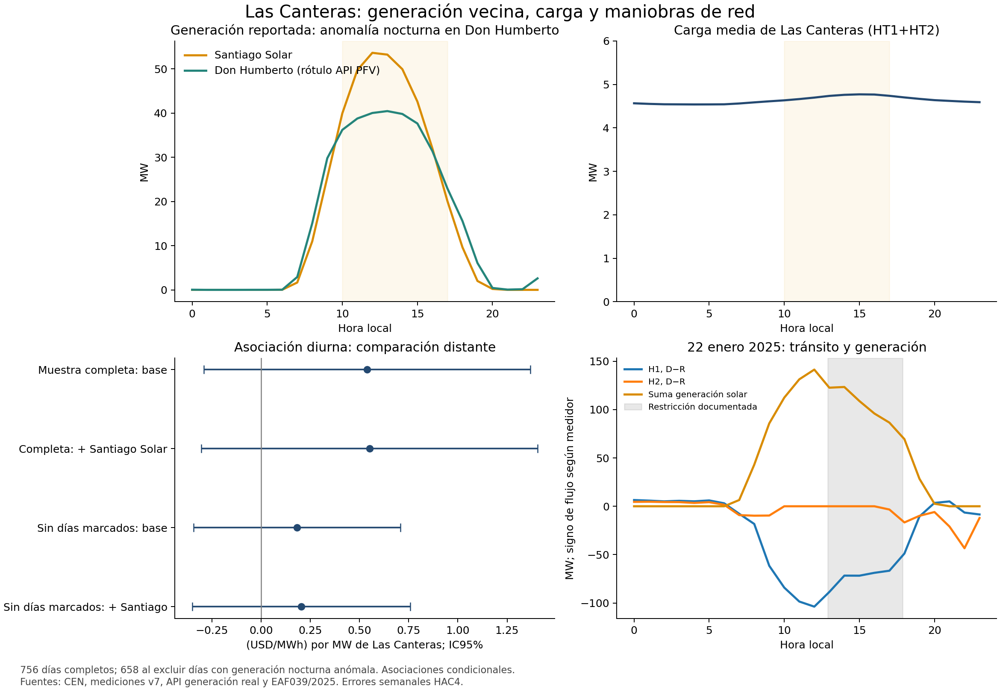

# Las Canteras: generación vecina y maniobras de red

**Resultado principal.** La asociación diurna entre carga de Las Canteras y diferencial de precios frente a cinco comparadores distantes pasa de **0,539 a 0,551 (USD/MWh)/MW** al incorporar Santiago Solar, sobre las mismas18.144 horas. Su intervalo de95% es **[−0,303;1,405]**. Incluir también la serie rotulada PFV Don Humberto apenas cambia ese valor, pero su auditoría detecta generación nocturna elevada: **no se certifica como fotovoltaica pura**. En una sensibilidad posterior que excluye98 días con esa anomalía, las pendientes sin/con Santiago Solar son **0,184/0,204**, ambas imprecisas. La señal es sensible a qué fechas se observan; su reducción entre muestras no es un efecto de controlar generación.

Se obtiene una medición más informada del mecanismo diurno y una discrepancia concreta de fuente que debe resolverse. Los ajustes son asociaciones condicionales, no un efecto causal cerrado ni una proyección a2030.

El avance se orienta a Energy Economics. Mantiene congelados el manuscrito y los resultados históricos SOCHER. El [protocolo](PROTOCOLO_GENERACION_20261011.md) se registró antes de las regresiones; distingue las adiciones documentales previas a estimar y las incidencias de procesamiento.

## 1. Qué se incorporó y validó

Se descargaron **36.530 registros** de las dos centrales desde la API oficial del CEN (`/generacion-real/v3/findByDate`, filtros idCentral364 y2209). Las respuestas identifican expresamente **PFV SANTIAGO SOLAR** y **PFV DON HUMBERTO**, tecnología Solar, variable `gen_real_mw`. Se archivaron seis páginas, incluidas dos vacías que verifican el final de la paginación. Son valores de generación reportada, distintos de los MW instruidos o disponibles en RIO. El rótulo fotovoltaico de Don Humberto requiere la salvedad de calidad documentada abajo.

- Se retiraron de los derivados **46 duplicados exactos**, concentrados en31-12-2025. Los originales y la tabla de duplicados permanecen íntegros.
- Dos registros de hora25 están fechados por la API en06-04-2025 00:00. Se conservaron en auditoría y se excluyeron del enlace; la hora1 regular de esa fecha se mantiene. No se reconstruye por suposición la hora repetida.
- La consulta larga termina en31-08-2026 00:00; faltan las siguientes23 horas. El día incompleto se excluye de todas las comparaciones principales. No se imputó generación cero.
- Se obtienen **18.144 horas de756 días completos**, agosto2024–agosto2026. El panel anterior tenía18.168 horas. La comparación sin/con generación usa exactamente la misma muestra.
- La alineación local `hora0=hora−1` se contrastó con48 valores impresos de generación real del22-01-2025 en [EAF039/2025](https://www.coordinador.cl/wp-content/uploads/2025/02/EAF-039-2025.pdf), pp43 y45. Diferencia máxima0,04MW, compatible con el redondeo de la tabla a una décima. Esta comprobación corrobora la convención de las series fotovoltaicas; no certifica todos los relojes de los medidores físicos.

Las dos series reportadas promedian, en el bloque10–16, **45,88 y37,77MW de media**, respectivamente: **83,65MW en conjunto**, frente a **4,72MW de HT1+HT2 de Las Canteras**. La diferencia de escala ayuda a entender por qué el tránsito diurno no debe interpretarse como consumo del centro. Ninguna de esas magnitudes equivale a capacidad disponible de la red.

**Hallazgo de calidad posterior a las primeras regresiones.** Don Humberto presenta **112 horas nocturnas sobre0,1MW en98 días**, considerando0–5 y22–23; Santiago Solar no presenta ninguna en esos horarios. Con umbral1MW hay93 horas en85 días. La figura permitió detectar este problema; se conserva el borrador previo en `historial/` y se registra la [adenda posterior](ADENDA_CALIDAD_GENERACION_20261011.md) antes de estimar las sensibilidades de calidad.

Una consulta diaria independiente reproduce el10-01-2026 a23:00 **44,20MW bajo PFV Don Humberto** y **44,85MW bajo BESS Don Humberto (inyección)**. La anomalía ya está en la API; no la creó el enlace local. La cercanía entre cifras sugiere posible mezcla de frontera o clasificación, pero un solo contraste no identifica el origen ni autoriza restar automáticamente ambas series.

El BESS aparece separado, con identificador de central nulo y registros de inyección, retiro de central y retiro del sistema. Una consulta del06-03-2025 también muestra sus registros separados; EAF108/2025 p67 contiene su inyección. **No se suman PFV y BESS ni se presentan las series como inyección neta del complejo.** Falta conciliar su historia completa con mediciones o balances independientes. Los controles con Don Humberto se mantienen como sensibilidad con la serie reportada. El ajuste solo con Santiago Solar permite continuar sin imponer una corrección no acreditada.

## 2. Estimación en muestras constantes

Resultado: precio medio de la zona menos precio medio de cinco comparadores distantes, en USD/MWh. Regresor: MW horarios de HT1+HT2. Se mantienen los bloques horarios, comparadores y efectos fijos de día, mes×hora y hora de la semana. Todas las filas incluyen el proxy físico Google previamente conciliado; sus límites de atribución siguen vigentes. Errores por scores semanales HAC4 sobre calendario completo y alternativa agrupada por mes. Las cifras son pendientes en **(USD/MWh)/MW**, distintas del efecto por primera entrada de la réplica histórica.

| Especificación | Horas | Pendiente diurna | IC95% semanal |
|---|---:|---:|---:|
| Base con Google, muestra común |18.144|0,539|[−0,289;1,368]|
| + Santiago Solar y Don Humberto (serie API con anomalías) |18.144|0,551|[−0,303;1,405]|
| + cuadrados de ambas generaciones |18.144|0,550|[−0,306;1,406]|
| + generación, excluyendo las tres fechas iniciales |18.072|0,551|[−0,303;1,406]|
| + generación, excluyendo también26-02-2025 |18.048|0,536|[−0,328;1,399]|

La auditoría posterior añade nueve modelos (225 contrastes). Sobre la muestra completa, **solo Santiago Solar** da0,551 [−0,303;1,405]. Excluyendo días con valores nocturnos de Don Humberto sobre0,1MW quedan15.792 horas de658 días: base0,184 [−0,342;0,709], solo Santiago0,204 [−0,350;0,758], ambas series0,204 [−0,350;0,758]. Con umbral1MW quedan16.104 horas de671 días y resultados prácticamente iguales. Esta selección usa calidad de la generación observada, no es exógena ni certifica que el resto de la serie Don Humberto sea pura. **La caída a0,20 se debe principalmente al cambio de muestra: la base ya cae a0,18.**

En los subperíodos agosto2024–julio2025 y agosto2025–agosto2026, las pendientes ajustadas son0,392 y0,374; ambas imprecisas. Los modelos sin generación sobre esas mismas muestras dan0,380 y0,363. No se comparan subperíodos como si compartieran la misma proyección de efectos fijos.

Los desfases de generación de−1 y+1 hora dan0,566 y0,539; sus bases respectivas son0,551 y0,540. No se elige el desfase por su coeficiente. Frente a comparadores cercanos, el ajuste solar da **−0,0077 [−0,0325;0,0170]**: la señal continúa dependiendo de la referencia espacial, con posibles efectos compartidos en la red cercana.

La diferencia ajustada entre pendiente solar y resto es0,422 [−0,255;1,099]. Ninguna diferencia entre bloques de la familia principal supera Holm5%; el menor p ajustado entre los24 contrastes es0,484. Se publican los **375 contrastes** de15 especificaciones y cinco resultados, incluidos signos negativos y resultados imprecisos.

La correlación entre generación de Santiago Solar y flujo firmado H1, después de los mismos efectos fijos, es **−0,617**; para Don Humberto es−0,380. Las correlaciones de la carga de Las Canteras con esas dos generaciones son0,025 y0,012. Esto es consistente con un componente solar importante en el tránsito, y ayuda a explicar por qué ajustar generación altera poco la asociación carga–precio. No identifica un efecto causal solar. El signo D−R depende de la orientación del medidor.

## 3. Qué aclaran las maniobras

El [calendario documental](resultados/20261011_maniobras_generacion_v1/eventos_documentados.csv) separa restricciones, fallas y solicitudes. Es una colección verificada de episodios, **no un calendario exhaustivo de estados de la red**.

**22 de enero de2025.** El control Las Canteras–Santiago Solar110kV entre12:54 y17:52 coincide con mantenimiento programado Las Canteras–Las Vegas y cambios de alimentación/protecciones de Punta Peuco. La solicitud menciona cambios requeridos tras la entrada de Don Humberto. La generación real suma141,37MW en la hora12 y122,66MW en la hora13; la carga HT1+HT2 se mantiene entre2,35 y2,52MW durante el día. El flujo H2 es cero entre10 y16 y el tránsito cambia de distribución. La reducción de generación coincide también con prorratas más generales: este día no permite atribuir toda su variación a una sola causa. Fuentes: EAF039/2025, pp43,45,58–68,101,136.

**26 de febrero de2025.** Los [EAF092](https://www.coordinador.cl/wp-content/uploads/2025/03/EAF-092-2025.pdf) y [EAF093](https://www.coordinador.cl/wp-content/uploads/2025/03/EAF-093-2025.pdf) documentan fallas sucesivas de los circuitos2 y1 Cerro Navia–Las Canteras, a13:36 y14:41, relacionadas con vegetación próxima a los conductores. Los tramos locales normalizan a19:40 y20:08; los otros extremos tienen horarios distintos. Los canales H3/H4 se anulan en las horas15–18 y el proxy TAP_R12 cae a cero, mientras HT1+HT2 permanece alrededor de2,85MW. La documentación acredita afectación de Dataluna; no demuestra un corte de la carga HT1+HT2 estudiada. EAF092 declara consumo previo de0MW en Las Canteras, cifra discordante con el agregado de medidores. Se conserva la discrepancia de frontera/reporte sin corregir ninguna fuente.

**6 de marzo de2025.** El diario CDC, incorporado como anexo al [EAF108/2025](https://www.coordinador.cl/wp-content/uploads/2025/03/EAF-108-2025.pdf), informa a14:12 una solicitud de desconexión forzosa para reparar un punto con temperatura en Cerro NaviaH3, a18:36 Las VegasHR cerrado, y a23:50 la línea cerrada y solicitud cancelada. **14:12 es el horario de la solicitud; no se certifica como apertura efectiva.** El canal H4 no es cero en ese intervalo, lo que exige verificar frontera, estado y calidad antes de usarlo como indicador de línea abierta. El título del EAF se refiere a una falla en otra región: aquí se utiliza exclusivamente su anexo nacional CDC, pp84,106–107.

**11 de febrero de2026.** El [IRF2026001051](https://www.coordinador.cl/wp-content/uploads/2026/02/IRF_11022026_Linea-de-110-kV-Punta-Peuco-Loma-Los-Colorados_IF2026001051.pdf) confirma una falla a12:15 y atribuye preliminarmente su origen a intervención fortuita durante trabajos en Rucasol. No informa en ese documento la normalización. Por eso no se inventa un intervalo completo de desconexión.

Las fallas de red afectan generación, otras cargas y precios directamente. **No son instrumentos válidos del consumo de Las Canteras por el solo hecho de ser imprevistas.** Sirven para estudiar mecanismos y la sensibilidad del resultado a cambios de configuración.

## 4. Qué aporta hacia la identificación causal

En las especificaciones examinadas, agregar Santiago Solar no elimina la señal diurna; excluir los cuatro días de maniobras tampoco la altera mucho. El ajuste con Don Humberto queda condicionado a su problema de clasificación. La sensibilidad de calidad muestra que el conjunto de fechas importa más que incorporar estas series como controles. La hipótesis de un efecto del consumo sigue abierta y ahora tiene una medición mejor delimitada. El resultado tampoco descarta efectos pequeños, compartidos con los comparadores o dependientes de una configuración particular.

La estrategia siguiente debe separar **variación de carga propia** de **variación de oferta y topología**:

1. Completar los retiros e inyecciones BESS y certificar el alcance de los canales de tránsito discrepantes. Obtener estados efectivos de interruptores o registros de maniobra con inicio y término, manteniendo desconocidos los intervalos sin evidencia.
2. Construir configuraciones operativas comparables y comprobar si existe suficiente variación de carga dentro de cada una. El modelo actual absorbe el crecimiento diario: la desviación residual del regressor MW, una vez considerados los demás términos, es aproximadamente0,142MW. Miles de horas no sustituyen variación independiente relevante.
3. Buscar arranques, pruebas o variaciones de carga de la instalación documentados con independencia de los precios y de obras simultáneas. La condición de exogeneidad debe argumentarse caso a caso. Si se obtiene, estimar respuesta local y efectos compartidos, con comparadores elegidos antes de observar sus respuestas.
4. Para el contrafactual estructural, mantener las mismas condiciones de oferta y red y retirar únicamente la carga del centro en un despacho validado. Sería una estimación causal condicionada al modelo y sus supuestos, distinta de la asociación observacional actual.

Esto define un avance concreto para Energy Economics: la pregunta pasa de una inauguración administrativa a la respuesta de precios a carga efectiva en configuraciones eléctricas observadas. Todavía no está cerrada la identificación ni se presenta una simulación2030.

## 5. Reproducción y preservación

[Panel y375 resultados iniciales](resultados/20261011_generacion_v3/), [auditoría de calidad y225 contrastes adicionales](resultados/20261011_calidad_generacion_v1/), [validación con EAF](resultados/20261011_generacion_v3/validacion_EAF_horas.json), [reproducción pública](resultados/verificacion_generacion_publica_20261011.json), [fuentes documentales con SHA-256](resultados/20261011_maniobras_generacion_v1/fuentes.json).

Se reprodujeron600 contrastes e intervalos desde los derivados públicos (375 de la primera comparación y225 de la auditoría posterior), con diferencia máxima4,5×10⁻¹³. Tres sistemas de coeficientes se comprobaron además con dummies explícitas y LSQR independiente, error menor a5×10⁻¹¹. Se verificaron13 insumos de esta estimación y nuevamente271 insumos protegidos de las etapas anteriores, sin diferencias. Las ejecuciones v1/v2 se conservaron como intentos detenidos antes de estimar; v3 es la vigente.

