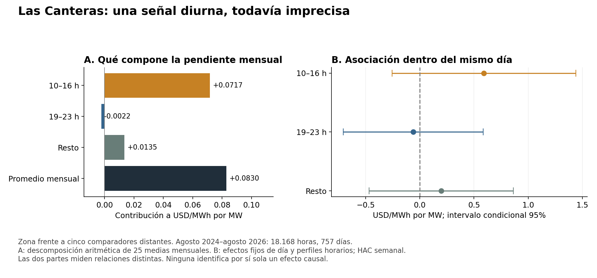

# Las Canteras y la heterogeneidad horaria de los precios

**El promedio mensual mezcla una asociación diurna positiva con una asociación de tarde-noche próxima a cero. Esa diferencia descriptiva justifica investigar el mecanismo horario, pero todavía no demuestra un efecto causal mayor en horas de alta carga o congestión.** La comparación intradiaria sigue siendo imprecisa y los episodios operativos disponibles son escasos.

Esta etapa prioriza el desarrollo del artículo para Energy Economics. El cierre y el manuscrito SOCHER permanecen intactos. Amplía la [estimación con comparadores externos](INFORME_CONTROLES_ZONALES_20261011.md), siguiendo un [protocolo guardado antes de los nuevos resultados](PROTOCOLO_HORARIO_20261011.md). Los análisis son exploratorios: ya se conocía la asociación mensual y sus problemas de comparación previa.

## Datos y pregunta que se contrastó

Se construyó un panel de **18.168 horas completas, 757 días y 25 meses**, agosto de 2024–agosto de 2026. El retiro físico de HT1+HT2, previamente conciliado con registros comerciales, se vinculó con precios publicados por hora local. Se excluyeron días de 23/25 horas y días incompletos. La equivalencia exacta entre la etiqueta física y el inicio/final del intervalo comercial sigue pendiente; por eso se repitió el análisis desplazando la carga una hora en ambas direcciones.

La zona conserva Batuco 110, Tap Libertadores 110 y Cerro Navia 110, con pesos iguales. Se mantienen sin nueva selección los cinco controles cercanos y los cinco/siete distantes del ejercicio anterior. El resultado principal mostrado aquí es **precio medio zonal menos precio de cinco comparadores distantes**; su unidad es USD/MWh. El retiro horario en MWh de un intervalo de una hora equivale numéricamente a MW medios. Ninguna hora adicional se cuenta como un centro o una intervención independiente.

Se separaron cuatro preguntas:

- Bloques fijos: 10–16 h, 19–23 h y resto. No son una clasificación oficial de punta ni de congestión.
- Carga elevada: retiro por encima del percentil 75 de su propio mes; representa 4.542 horas. Se permite cambiar la pendiente de manera continua al superar ese umbral.
- Precio sistémico elevado: Quillota igual o mayor a 100 USD/MWh, 9,74% de las horas. Es un diagnóstico de estado de precio, **no una medida independiente de congestión**.
- Restricción documentada: estados de control de transferencias en Alto Jahuel–Lo Aguirre 500 kV, en tres días con registros operativos completos revisados. No se extrapola ese estado al resto del período.

## 1. Qué queda diluido al promediar el mes

La pendiente mensual agregada anterior, **+0,0830 USD/MWh por MW**, se reconstruye exactamente desde el nuevo panel horario. Para descomponerla se usa el mismo retiro medio mensual total como regresor en todos los bloques; así las contribuciones son sumables.

| Bloque | Peso horario | Pendiente del precio de ese bloque frente al retiro medio mensual total | Contribución a la pendiente mensual |
|---|---:|---:|---:|
| 10–16 h | 7/24 | +0,2459 | **+0,0717** |
| 19–23 h | 5/24 | −0,0107 | −0,0022 |
| Resto | 12/24 | +0,0271 | +0,0135 |
| Total | 1 | — | **+0,0830** |

Aproximadamente el **86% de la pendiente agregada** procede aritméticamente del bloque 10–16 h, aunque representa el 29% de las horas. Esto identifica dónde se concentra la asociación observada, no qué parte del precio es causada por el centro de datos. La ligera contribución negativa de tarde-noche no demuestra un efecto de reducción de precios.

Si se utiliza el retiro propio de cada bloque, las pendientes mensuales son +0,2328 en 10–16 h, −0,0112 en 19–23 h y +0,0293 en el resto. Esas tres pendientes usan regresores diferentes y **no deben sumarse**.

Fuentes: [descomposición exacta](resultados/20261011_episodios_horarios_v1/descomposicion_pendiente_mensual.csv) y [pendientes por bloque](resultados/20261011_horas_v1/pendientes_mensuales_por_bloque.csv).

## 2. Qué ocurre al estimar directamente con horas

Se estimaron dos estructuras temporales:

**A. Mes y hora de la semana.** Descuenta el nivel de cada mes y perfiles semanales habituales, pero conserva diferencias entre días del mismo mes. La pendiente lineal es **+0,5335**, con intervalo condicional 95% [0,1137; 0,9533]. La pendiente solar es +0,6148 [0,1648; 1,0649]. Sin embargo, que una pendiente sea positiva y otra imprecisa no demuestra que sean distintas entre sí: las diferencias de bloques frente al resto no superan el ajuste de multiplicidad para el resultado distante.

**B. Día, mes×hora y hora de la semana.** Compara cambios dentro del mismo día, descontando además perfiles horarios propios de cada mes. Sus resultados son:

| Relación con el retiro físico | Pendiente, USD/MWh por MW | Intervalo condicional 95% |
|---|---:|---:|
| Lineal, todas las horas | +0,4361 | [−0,2162; 1,0885] |
| Bloque 10–16 h | **+0,5912** | [−0,2558; 1,4382] |
| Bloque 19–23 h | −0,0609 | [−0,7065; 0,5848] |
| Resto | +0,1977 | [−0,4671; 0,8625] |
| Carga hasta percentil 75 | +0,1140 | [−0,7024; 0,9304] |
| Carga sobre percentil 75 | +0,7989 | [−1,1133; 2,7111] |

La diferencia entre las dos pendientes de carga es +0,6849, con intervalo [−1,7285; 3,0983]. Por tanto, **no queda comprobado un aumento especial de la respuesta al superar la carga alta**, aunque la estimación puntual sea mayor.

A y B no identifican exactamente el mismo objeto: B elimina la variación entre días, incluida buena parte de la rampa de utilización. La desviación estándar de la carga pasa de 2,744 MW en bruto a 0,439 después de los efectos de A y a 0,181 después de los de B. Su imprecisión no permite declarar inexistente un efecto de largo plazo; muestra que la variación intradiaria independiente disponible es pequeña.

Los intervalos usan scores agregados por semana y HAC Bartlett de cuatro semanas, con 110 bloques temporales; se conserva una alternativa agrupada por mes. Son inferencias condicionales de series temporales, no inferencia causal entre múltiples centros. Se aplicó Holm a las 16 pruebas de diferencias de pendientes de cada estructura temporal, entre cuatro resultados de brecha. La referencia D frente a Quillota se conserva por separado.

Existe un resultado de signo contrario que también se informa: frente a controles cercanos, la diferencia de pendientes entre precio sistémico alto y bajo es **−0,0187**, con p ajustado 0,00083 en B. La clasificación depende de Quillota contemporáneo y puede recoger pérdidas y condiciones comunes; no permite concluir que Las Canteras reduzca costos ni que exista un mecanismo de congestión identificado.

## 3. Estabilidad de la señal diurna

Con siete comparadores distantes, la pendiente intradiaria solar es +0,5898, muy próxima a +0,5912 con cinco. En Canteras 110, comparada directamente con los cinco, es +0,5850. Frente a los controles cercanos, la pendiente solar zonal es −0,0067 [−0,0330; 0,0196]. Persiste la dificultad de distinguir una señal regional compartida de un efecto propio de la conexión.

La pendiente solar de B mantiene el signo en los dos subperíodos: +0,4624 en agosto de 2024–julio de 2025 y +0,3890 en agosto de 2025–agosto de 2026; ambos intervalos incluyen cero. Los desfases físicos de −1 y +1 hora producen +0,4693 y +0,7186, también imprecisos. La tarde-noche cambia de signo entre subperíodos (+0,3724 y −0,5292).

Estas comprobaciones hacen de la franja diurna una pista que merece seguimiento. No establecen que su pendiente supere estadísticamente a las demás ni acreditan el reloj de los medidores. Todas las especificaciones y signos están en [resultados principales](resultados/20261011_horas_v1/estimaciones_principales.csv) y [robusteces](resultados/20261011_horas_v1/robusteces_bloques.csv).

## 4. Qué muestran los episodios con restricción documentada

Se revisaron los registros operativos de los EAF 499/2024, 519/2024 y 534/2024 del Coordinador: 30, 54 y 45 páginas de bitácora, respectivamente. Se extrajeron los hitos de control de transferencias para el 7 y 26 de octubre y el 6 de noviembre de 2024. Las horas parciales de transición se excluyen de la clasificación; para el 6 de noviembre no se presupone el estado desde medianoche y se comienza con la prorrata explícita de las 01:34.

| Día | Horas completas con restricción / sin ese control | Brecha zonal frente a distantes con restricción | Brecha sin ese control | Carga Las Canteras con / sin, MW |
|---|---:|---:|---:|---:|
| 07-10-2024 | 7 / 16 | 2,240 | 0,985 | 2,005 / 2,043 |
| 26-10-2024 | 8 / 14 | 3,677 | 0,521 | 1,867 / 1,952 |
| 06-11-2024 | 4 / 16 | 2,807 | 0,651 | 1,976 / 2,061 |

Las restricciones coinciden con brechas mayores, **sin que la carga de Las Canteras sea mayor en esas horas**. Esto confirma que debemos observar la operación de red para interpretar los precios; no atribuye el episodio al centro ni demuestra que una misma carga tenga determinado efecto causal bajo congestión. Cambian simultáneamente horario, despacho y demanda del resto del sistema. “Sin ese control” tampoco significa ausencia de otras restricciones.

Solo hay 19 horas completas clasificadas con restricción, 46 sin ese control y 7 de transición o estado desconocido en esos tres días. El resto del panel conserva estado operativo desconocido. Los casos están concentrados cuando HT1+HT2 retiraban alrededor de 2 MW, antes de alcanzar los niveles de 2026: no permiten estimar de forma representativa una interacción carga×congestión para toda la rampa.

Documentación: [eventos extraídos y páginas](resultados/20261011_episodios_horarios_v1/eventos_extraidos_CEN.csv), [intervalos interpretados](resultados/20261011_episodios_horarios_v1/intervalos_interpretados.csv), [tabla horaria](resultados/20261011_episodios_horarios_v1/episodios_horarios.csv). Fuentes primarias: [EAF 499/2024](https://www.coordinador.cl/wp-content/uploads/2024/10/EAF-499-2024.pdf), [EAF 519/2024](https://www.coordinador.cl/wp-content/uploads/2024/11/EAF-519-2024.pdf), [EAF 534/2024](https://www.coordinador.cl/wp-content/uploads/2024/11/EAF-534-2024.pdf).

## Implicación para el artículo principal

La agregación mensual efectivamente reduce la visibilidad de una asociación concentrada en horas diurnas. El análisis horario no convierte automáticamente esa asociación en causal: las diferencias entre bloques y niveles de carga no están suficientemente precisadas, la comparación distante conserva sus problemas de evolución previa y todavía faltan demanda zonal restante y operación continua.

El siguiente avance con mayor rendimiento para Energy Economics es **construir un calendario operativo continuo de restricciones, flujos y disponibilidad para las zonas tratada y comparadoras**, cubriendo tanto los niveles de carga iniciales como los de 2026. Permitirá contrastar por qué emerge la señal diurna y si cambia con restricciones específicas, en lugar de aproximar congestión mediante precios altos. También debe distinguirse la exposición de cada comparador a esas mismas restricciones y la evolución simultánea de Google, Ascenty y generación local. Una interacción con una restricción observada no es por sí sola exógena: la demanda puede contribuir a activarla.

El resultado de esta etapa es una hipótesis horaria más concreta y un panel listo para contrastarla. Se mantiene abierta la posibilidad de efectos compartidos o sostenidos que las comparaciones intradiarias no identifican.

## Trazabilidad y verificaciones

Se preservaron por SHA-256 los 31 insumos del análisis horario y los seis de la revisión de episodios. La comprobación independiente reconstruyó el panel mensual anterior con error máximo 3,6×10⁻¹⁵ y contrastó la estimación intradiaria mediante dummies explícitas y otro método numérico, con diferencia máxima 1,2×10⁻¹¹. Las pendientes e interacciones cumplen sus identidades algebraicas.

La [reproducción desde el panel público](resultados/20261011_horas_v1/reproduccion_publica.json) recuperó las 40 regresiones y los 120 contrastes principales, incluidos ambos cálculos de errores estándar, con diferencias menores a 9×10⁻¹⁶ y sin requerir las bases originales.

La verificación general de 271 insumos y del tag v0.3.0 volvió a pasar. Las bases, los resultados anteriores y el manuscrito SOCHER no fueron modificados. La figura se inspeccionó visualmente. El [panel público](resultados/20261011_horas_v1/panel_horario.csv.gz), la [verificación independiente](resultados/20261011_horas_v1/verificacion_independiente.json), la [bitácora](BITACORA.md) y las [instrucciones de reproducción](REPRODUCCION.md) permiten revisar este avance por separado.
