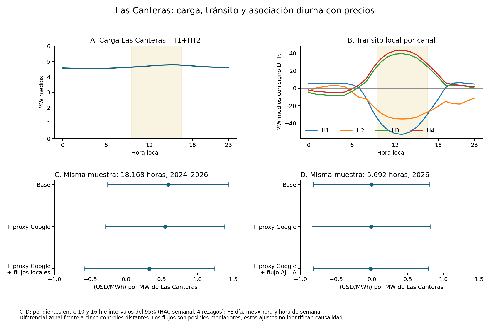

# Las Canteras: calendario operativo, flujos y cargas concurrentes

Investigación orientada a Energy Economics, 11 de octubre de 2026. Se conserva íntegro el cierre SOCHER y el análisis anterior. Punto de partida: commit `690987f`. Reglas en el [protocolo](PROTOCOLO_OPERACION_20261011.md) y la [adenda de obtención y clasificación](ADENDA_OPERACION_20261011.md).

## Qué aporta esta etapa

La señal diurna puede contrastarse ahora con mediciones de tránsito, una aproximación física a la carga de Google y registros oficiales de operación. La carga de Google por sí sola apenas cambia la asociación de Las Canteras. El tránsito local presenta una variación diurna mucho mayor que el consumo del centro y la asociación no se reproduce con igual magnitud en la muestra de 2026. Estos resultados delimitan un mecanismo de red que debe examinarse junto con la generación local y las maniobras.

Se mantiene la misma zona, los comparadores ya seleccionados y los bloques horarios. Las nuevas especificaciones son exploratorias: se conocía la señal previa. Las regresiones caracterizan asociaciones condicionales; todavía no separan una variación exógena de demanda del resto de los cambios del sistema.

## Consumo y tránsito: dos mediciones distintas

El panel conserva **18.168 horas de 757 días**, agosto de 2024–agosto de 2026. Se recuperaron doce canales con sus direcciones D y R por separado; HT1+HT2 reproduce la carga anterior con diferencia máxima de 2,7×10⁻¹⁵ MW. El calendario UTC contiene 18.264 horas: no se rellenaron las horas excluidas del panel de precios.

La suma R de los dos canales de Tap Libertadores concilia con los retiros comerciales de Google en **1.528 horas de 64 fechas**: error absoluto ponderado de **0,868%**, correlación 0,984 y diferencia media de 0,031 MW. Es una aproximación empíricamente respaldada a esa carga, cuya correspondencia no se declara certificada para todos los meses. Los tres canales LBR de Chacabuco no presentan esa conciliación y permanecen separados, sin atribución de operador. Google físico y comercial nunca se suman entre sí.

El catálogo vincula H1/H2 de Las Canteras con Tap Batuco y H3/H4 con Tap Libertadores. [Extracto de extremos y secciones](resultados/20261011_topologia_operativa_v1/canales_y_extremos.csv). Su configuración es compatible con tránsito compartido por la subestación. Los límites de las ocho secciones se conservan con su certificación: valores nominales actuales en MVA no permiten reconstruir, por sí solos, la capacidad operativa histórica bajo N−1 ni declarar saturación a partir de MW.

| Medición | Horas 10–16 | Resto, excluyendo 19–23 |
|---|---:|---:|
| Carga media HT1+HT2, MW | 4,725 | 4,592 |
| Magnitud media del flujo H1, MW | 46,835 | 14,054 |
| Magnitud media del flujo H2, MW | 33,523 | 17,875 |

La circulación aumenta mucho más que el consumo del centro durante el bloque diurno. Los cuatro canales de línea no son cuatro consumos: sumar sus magnitudes contaría parte del tránsito más de una vez. Su balance con los transformadores es un diagnóstico de consistencia, no una certificación exhaustiva de frontera.

## Ajustes por otras cargas en muestras comparables

Resultado: diferencial de precios de la zona frente a cinco controles distantes. Pendiente por MW adicional de carga Las Canteras durante las 10–16 horas, en `(USD/MWh)/MW`. Efectos fijos de día, mes×hora y hora de semana; intervalos del 95% con scores semanales HAC y cuatro rezagos. Se conservan también errores agrupados por mes y ajuste Holm de las comparaciones horarias.

| Especificación | Horas | Pendiente diurna | Intervalo 95% |
|---|---:|---:|---:|
| Base física | 18.168 | 0,591 | [−0,256; 1,438] |
| + aproximación física Google | 18.168 | 0,549 | [−0,283; 1,380] |
| + Google y tres canales LBR separados | 18.168 | 0,548 | [−0,298; 1,394] |
| + cuatro flujos locales | 18.168 | 0,376 | [−0,551; 1,303] |
| + Google y cuatro flujos locales | 18.168 | 0,328 | [−0,583; 1,239] |
| Base en días comerciales completos | 1.464 | 1,151 | [−2,364; 4,666] |
| + retiros Google y dos claves Ascenty | 1.464 | 1,302 | [−2,118; 4,722] |

El ajuste por Google apenas altera el coeficiente. Los 61 días comerciales permiten una segunda comparación, con precisión considerablemente menor. No se compara 1,302 con 0,549 como si su diferencia procediera de los controles: pertenecen a muestras diferentes.

Los flujos pueden responder al consumo y actuar como mediadores. Además, su suma algebraica es casi redundante con HT1+HT2 (correlación −0,996). La reducción de pendiente al introducirlos no mide un porcentaje causal explicado. Ninguna diferencia diurna frente al resto supera el ajuste Holm de esta familia de pruebas. [Todas las estimaciones](resultados/20261011_estimacion_operacion_v1/estimaciones.csv).

## Flujo de 500 kV y cambio temporal

La exportación oficial Qlik de Lo Aguirre–Alto Jahuel C1 contiene ambos extremos y 48.110 registros. Antes de 2026 combina casi todos ceros con algunas magnitudes incompatibles con la unidad declarada. Se guarda el CSV exacto y se excluye ese tramo de la sensibilidad, sin corregirlo o reescalarlo.

En la muestra común de **5.692 horas de 2026**, la pendiente diurna es **−0,005** en la base, **−0,011** al añadir Google y **−0,016** al incorporar también el flujo de 500 kV. Sus intervalos abarcan aproximadamente −0,84 a 0,82. La señal ya es próxima a cero antes de controlar ese flujo: el cambio respecto del panel completo refleja diferencias de período/muestra, no un efecto demostrado del ajuste.

Los extremos pareados tienen correlación −0,998; un 92,1% cumple la tolerancia descriptiva de balance (5 MWh o 5% de la magnitud media). Se retienen también las discrepancias. La convención horaria del exportador y la validez metrológica requieren confirmación externa; por ello este ejercicio se informa como sensibilidad. [Auditoría y resultados](resultados/20261011_flujo500_v1/verificacion.json).

## Calendario de restricciones: cobertura y comparación

Se completó la paginación de **25 consultas mensuales** al RIO: **2.251.700 registros** en263 páginas, incluidas25 páginas finales vacías. La auditoría encuentra15.201 duplicados exactos y40 registros con identificadores discordantes, conservados y excluidos del procesamiento. Los discordantes no mencionan Alto Jahuel–Lo Aguirre. La descarga contiene747 fechas de las761 solicitadas; **14 fechas no tienen registros**. Por tanto, descarga terminada no significa cobertura diaria completa.

En el panel de precios hay evidencia RIO para744 de757 días. El estado del control de transferencia Alto Jahuel–Lo Aguirre500kV se reconstruye con inicios/finales explícitos y anotación inicial de zona; no se arrastra entre días. La falta de mención permanece desconocida. El calendario conserva prorrata por separado.

| Estado Ctx AJ–LA | Horas del panel | Horas 10–16 |
|---|---:|---:|
| Restricción documentada durante toda la hora | 198 | 18 |
| Estado posterior a término documentado, sin nuevo inicio identificado | 812 | 320 |
| Desconocido o transición | 17.158 | 4.961 |

Las18 horas solares restringidas corresponden a **7 y8 de junio y12 de julio de2025**. No se encontraron menciones a ese corredor de500kV en2026 en esta extracción; esto no prueba ausencia de restricciones. El estado0 se refiere únicamente a ese control, no a toda la congestión del sistema. Los tres EAF previamente revisados concuerdan en15 horas Ctx y46 horas posteriores a su término; cuatro horas antes agrupadas como restricción son prorrata y se conservan separadas.

El ajuste utiliza **1.010 horas de50 días,10 meses y18 semanas observadas**. En el modelo con Google que impone una diferencia de pendiente común a todos los bloques, la interacción carga×Ctx es **−7,790**, intervalo[−13,887;−1,694], **p ajustado Holm=0,086**. Se informa el signo contrario al incremento esperado; la estimación es inestable y depende de escaso soporte temporal. Ninguna interacción de esta familia supera el umbral del5% tras Holm.

La especificación que permite una respuesta Ctx distinta por bloque **no es estimable**: rango9 para10 columnas. Se conserva ese diagnóstico, sin retirar términos para forzar un resultado. Esta muestra seleccionada de horas clasificables no representa todas las horas libres de restricciones y no es comparable directamente con las18.168 horas del análisis principal. [Resultados y estimabilidad](resultados/20261011_estimacion_rio_v3/estimabilidad.csv).

El [calendario integrado horario](resultados/20261011_calendario_local_v1/calendario_integrado.csv.gz) enlaza carga, flujos, otras cargas, precios, Ctx, prorrata y el episodio local revisado. El [resumen diario](resultados/20261011_calendario_local_v1/calendario_diario_resumen.csv) facilita su inspección. Los estados crudos usan etiquetas horarias locales; las regresiones conservan la exclusión previa de días de cambio de hora.

## Un episodio local con respaldo documental

El **22 de enero de 2025**, el RIO registra control de transferencia y prorrata en Las Canteras–Santiago Solar entre **12:54 y 17:52**. El EAF039/2025 permite enlazarlo con una desconexión programada para mantenimiento de Las Canteras–Las Vegas, solicitud **SD2025004130**: identifica las secciones 5186/5187, vinculadas al canal H2. Otra solicitud documenta cambios de protecciones y de alimentación en Punta Peuco, relacionados con esa faena y con la incorporación de Don Humberto.

El registro operativo anota ajustes de generación para Don Humberto y Santiago Solar. Las mediciones muestran **H2 en cero durante siete horas completas, 10–16**, mientras H1 concentra tránsito. La carga HT1+HT2 permanece entre **2,35 y 2,52 MW** durante el día. Es evidencia concreta de un estado de red y generación distinto, con consumo relativamente estable. No basta para atribuir la asociación del período completo a esa faena ni al centro de datos.

Referencias exactas: PDF pp.58 y65 (instrucciones), p.101 (intervención relacionada), p.136 (desconexión). La hora de inicio indicada en la solicitud es programada; no sustituye la hora efectiva de maniobra. Las cuatro horas completas 13–16 se clasifican como restringidas y las horas12 y17 como transición. [Serie del episodio](resultados/20261011_calendario_local_v1/episodio_20250122.csv).

El extracto local conserva además menciones del **6 de marzo de2025** a una desconexión de curso forzoso en Las Canteras–Cerro Navia y del **11 de febrero de2026** a una salida de generación de7MW vinculada a Punta Peuco–Loma Los Colorados. Quedan como eventos que requieren reconstrucción de duración y equipos, no como horas ya clasificadas. El RIO extraído no sustituye un calendario exhaustivo de maniobras y fallas.

## Qué permite investigar a continuación

El hallazgo local hace más concreta la pregunta para Energy Economics: **cómo cambia la respuesta de los costos marginales a la carga digital según la dirección de los flujos, la generación disponible y la configuración de la red**. La mayor circulación diurna y el episodio solar documentado justifican estudiar esos estados; todavía no prueban cuál explica la pendiente agregada.

1. Completar la serie de generación efectiva de Santiago Solar y Don Humberto, distinguiéndola de consignas de despacho y disponibilidad declarada; incorporar temperatura e irradiación para examinar variación meteorológica simultánea. El RIO aporta decisiones operativas; no reemplaza una serie de energía efectivamente generada.
2. Extender el enlace entre solicitudes de desconexión, equipo, horario efectivo y mediciones, empezando por las secciones del episodio comprobado. Los ceros de un canal son señales para revisar, no evidencia suficiente de una línea abierta.
3. Definir la exposición por carga medida y configuración previa de red. Examinar si el incremento de consumo coincide con mayor importación o con absorción de generación local; el signo del efecto sobre precios puede depender del estado operativo.
4. Construir la identificación alrededor de cambios de utilización o conexión cuya fecha y motivo puedan documentarse, contrastando anticipación, otras cargas y cambios simultáneos. Una desconexión afecta directamente los precios: no sería un instrumento válido de la carga del centro solo por estar programada.

Así, el calendario pasa de ser una covariable genérica a una herramienta para escoger comparaciones físicamente defendibles. La evidencia actual respalda avanzar en ese diseño y conserva tanto los resultados positivos como los que no los reproducen.

## Fuentes y trazabilidad

Se preservan los originales físicos y comerciales, los precios anteriores y el manuscrito. Cada ejecución escribe derivados en una carpeta nueva y comprueba las huellas de sus insumos antes y después. La [bitácora](BITACORA.md) conserva también descargas incompletas, errores y decisiones posteriores. Los resultados tabulares publicados permiten reproducir las regresiones sin los 26 GB de originales; las reextracciones físicas sí requieren los insumos locales.

Fuentes operativas: [RIO del Coordinador](https://www.coordinador.cl/operacion/documentos/registro-de-instrucciones-de-operacion-rio-sscc-energia/), API pública SIP de instrucciones operacionales CMg, [potencia transitada del Coordinador](https://www.coordinador.cl/operacion/graficos/operacion-real/potencia-transitada-por-el-sistema-de-transmision/), catálogo Infotécnica previamente archivado y [EAF039/2025](https://www.coordinador.cl/wp-content/uploads/2025/02/EAF-039-2025.pdf). El EAF incorpora el registro diario del 22 de enero: no se atribuye una restricción de ese registro a la falla que encabeza el informe sin evidencia adicional.
