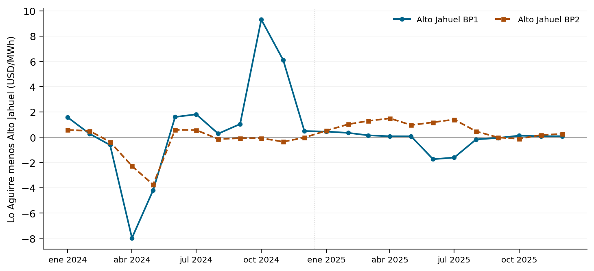

# Cuánto cambia la valoración de una gran carga al identificar su barra de conexión

**Actualización al 20 de noviembre de 2026.** La etapa 3 de Alto Jahuel–Lo Aguirre cambió legalmente de alcance. A la vez, el cruce de las mediciones con las soluciones PLEXOS muestra que una ubicación definida solo por subestación y tensión puede invertir el orden de costo entre dos sitios. Presentamos un resultado propio sobre costo de compra a precios históricos, un antecedente regulatorio sobre la inversión y una prueba prospectiva del despacho. El beneficio de adelantar la obra con carga adicional sigue por estimar.

## Resultado de localización con dos años completos

Se considera una carga plana e hipotética de 50 MW durante todas las horas físicas del año. La diferencia de gasto en energía se calcula a precios marginales publicados y con los precios fijos. Un valor positivo significa que comprar en Lo Aguirre cuesta más que comprar en la barra de comparación de Alto Jahuel. La cuenta excluye peajes, contratos bilaterales, IVA, potencia y cualquier cambio de precio causado por la demanda adicional.

| Año | Horas | Lo Aguirre menos Alto Jahuel BP1 (USD/MWh) | Frente a BP2 (USD/MWh) | Diferencia anual frente a BP1 | Diferencia anual frente a BP2 |
|---|---:|---:|---:|---:|---:|
| 2024 | 8.784 | +0,813 | −0,413 | +USD 357.141 | −USD 181.331 |
| 2025 | 8.760 | −0,190 | +0,712 | −USD 83.108 | +USD 311.965 |

**Una cota demostrable.** Si se reemplazan los dos gastos anuales de Alto Jahuel por un único gasto estimado G, al menos uno de los dos errores absolutos alcanza la mitad de la distancia entre los gastos de BP1 y BP2. Esto se sigue de la desigualdad triangular, y el punto medio alcanza esa cota. A 50 MW, el error mínimo inevitable en el peor de los dos sitios es **USD 269.236 en 2024** y **USD 197.536 en 2025**. Se permite incluso elegir el mejor valor agregado después de observar el año. La afirmación vale para valorar ambas ubicaciones con un mismo precio y perfil. Si se conoce la barra de un único cliente, se usa su precio. La cota se refiere al gasto spot histórico, no al error en el costo social o en el beneficio del refuerzo. Las dos magnitudes anuales no se suman para afirmar que la misma barra acumuló ambos errores.

Como sensibilidad, si w representa la ponderación de BP1 en un precio agregado de Alto Jahuel y 1−w la de BP2, ambos sitios empatan en costo con Lo Aguirre cuando w es 33,68 % en 2024 y 78,96 % en 2025. Son puntos de indiferencia aritméticos. Para asignar una demanda real se requiere la conexión física. Los promedios anuales ocultan diferencias dentro del año. Por ejemplo, en octubre de 2024 la brecha media frente a BP1 fue +9,30 USD/MWh y frente a BP2 fue −0,08. En las 98 horas completas con control de transferencia, alcanzaron +57,65 y −0,08, respectivamente. La bitácora señala el estado del corredor; atribuir la diferencia a una maniobra concreta requiere la topología efectiva.

Se utilizó el panel publicado en el proyecto. Los códigos de costo marginal son LO_AGUIRRE____220 (ID 1536), A.JAHUEL______220 (ID 457, BP1) y A.JAHUEL2_____220 (ID 1706, BP2). Para Lo Aguirre el nombre descriptivo del CEN indica 230 kV BP1 y el código comercial termina en 220. Los tres registros tienen el mismo número de horas por mes. Se combinaron las dos partes de julio de 2024 y se verificó en los archivos definitivos que los cuatro cuartos de la hora local inexistente de septiembre tienen precio cero en las tres barras en ambos años. La serie horaria independiente de octubre reconcilia con el panel mensual. El año 2025 se analizó después de observar el piloto; se trata de una comprobación retrospectiva.



[Figura en PDF](brecha_por_barra.pdf) · [Código de la figura](figura.py)

## Qué precio se puede validar en PLEXOS

Se contrastaron los 31 modelos diarios de octubre de 2024 con sus 31 planillas PRG y con los precios definitivos del CEN. Se lee el primer día del horizonte y se verifican índices, unidades de los precios, fecha, flujo y marca de congestión contra la extracción anterior. Para Quillota 220 kV, el precio exportado por PLEXOS, truncado en cero, reproduce las **744** cifras horarias de la planilla: hay 497 coincidencias directas y 247 valores negativos del modelo que figuran como cero en PRG (tolerancia 0,00001 USD/MWh). Esa concordancia verifica el lector con una referencia distinta de los flujos.

| Comparación en octubre de 2024 | Resultado |
|---|---:|
| Campos Price de AJahuel500 y LoAguirre500 y Rental de la línea | Cero en 744 de 744 horas |
| Horas que PLEXOS marca congestionadas en la línea, incluyendo transiciones reales | 304 |
| Horas con brecha realizada positiva a 500 kV | 431 |
| Brecha media programada LoAguirre220 − AJahuel220 | 11,50 USD/MWh |
| Brecha realizada a 220 kV respecto de BP1 / BP2 | +9,30 / −0,08 USD/MWh |
| Error absoluto medio horario del programa usando BP1 como comparación | 9,37 USD/MWh |

El campo archivado en 500 kV no sustenta un ahorro marginal de cero. La exportación funciona para Quillota y devuelve precios distintos de cero en 220 kV. Para la comparación programada se usaron los precios firmados de la solución, conservando negativos. El nodo del modelo AJahuel220 no establece por su nombre una equivalencia física con BP1 o BP2. La lectura de ambas barras reales muestra la sensibilidad a esa elección. Mantener en el contrafactual el nivel de conexión del cliente y la representación explícita de barras y transformadores.

## La obra que se puede evaluar desde octubre de 2026

El Decreto Supremo 15T, fechado el 4 de septiembre y publicado el **27 de octubre de 2026**, modificó la adjudicación del NUP 1530. El estándar de 3.000 MVA por circuito quedó como diseño histórico. El alcance vigente exige al menos **1.950 MVA por circuito a 35 °C con sol** y contempla intervenciones parciales. El informe del Coordinador sobre la tramitación anterior documenta un cronograma rechazado por el efecto de desconexiones prolongadas y por el riesgo para la operación. El decreto recoge la reconsideración de abril de 2026. [Diario Oficial, CVE 2891196, artículos 1 y 2](https://www.diariooficial.interior.gob.cl/publicaciones/2026/10/27/44584/01/2891196.pdf) · [Informe técnico sobre el alcance original](https://cartas.coordinador.cl/download_anexos/6911fe0035635711a251937d/0)

El 3 de noviembre Transelec informó una referencia de **1.250 MVA por circuito** antes de la habilitación. Esto implica un aumento nominal de **700 MVA por circuito** bajo el nuevo alcance. El titular indica que los trabajos previos mantienen la capacidad vigente hasta la aprobación de los requisitos de puesta en servicio, incluido el estudio de coordinación y ajuste de protecciones. Se pudo leer el estudio público de sensibilidad EEMT-2026-917-1114-R0: su objeto es el desempeño de protecciones tras un cambio parcial de conductor. La tabla 5-4 informa una variación de 0,0269 % en la reactancia de secuencia positiva del enlace estudiado. El anexo no entrega un ensayo económico con y sin obra ni determina la transferencia segura en MW del sistema completo. El límite modelado de 1.660 MW de octubre de 2024, la referencia del titular en 2026 y el límite seguro N−1 tienen definiciones y fechas distintas. [Carta del titular del 3 de noviembre y anexos](https://cartas.coordinador.cl/show/6aecee7f35635758766e2efa)

Como contraste descriptivo, se contó cuántas horas la magnitud del flujo activo del corredor excede **1.250 MW**, techo hipotético que usa factor de potencia unitario. En octubre de 2024 fueron 285 horas medidas y 442 programadas. En enero de 2025 fueron 55 y 82. La suma del exceso medido fue 73,53 y 10,45 GWh; el programa dio 154,57 y 16,10 GWh. En ambos meses todos los excesos fueron en el sentido Alto Jahuel → Lo Aguirre. Al elevar el techo hipotético a 1.950 MW quedaron cero horas en los dos meses. Se evalúa el flujo total histórico en ambos circuitos; no se observó el mismo flujo tras perder uno. Las cifras describen exposición a un techo aritmético. Para convertirla en redespacho hace falta redistribuir flujos, verificar contingencias y considerar potencia reactiva y condiciones efectivas. Ni los GWh de exceso ni su producto con un precio constituyen energía no servida o ahorro.

## Qué dólares pertenecen a cada decisión

* **Evaluación oficial anterior.** En el informe técnico final del Plan 2018, sección 7.1.4.1, tabla 53, la CNE publicó costos esperados de operación y falla con y sin el proyecto original, incluido un banco de transformación. Las diferencias de las filas redondeadas dan 33, 217, 82, 77 y 207 millones de USD en valor presente según escenario. Con AVI al 7 %, la fila oficial de beneficios netos informa −29, +154, +19, +14 y +144 millones. Cuatro de cinco escenarios favorecen el proyecto original. Es un antecedente que el artículo debe explicar: la inversión ya tenía una justificación sistémica en escenarios de generación. La tabla no aísla una nueva carga de centro de datos ni el adelanto de un año de la etapa 3 reformulada. [CNE, informe final, p. 164](https://www.cne.cl/wp-content/uploads/2018/01/Res-Ex-CNE-14-2019-ITF-Plan-Expansion-Anual-Tx-2018.pdf)
* **Costo de ejecutar la etapa vigente.** La carta DE04392-25 exige desglosar USD 2.220.180 asignados a una opción, además del cronograma y facturas. El registro de la respuesta DE07127-25 de 25 de julio de 2025 figura como confidencial. La evidencia pública revisada no permite asignar el monto completo a costos pendientes evitables de la obra autorizada en 2026. Se mantiene como desconocido el valor presente de desplazar el calendario de desembolsos de esa etapa. Tampoco se imputa una proporción del costo total adjudicado a partir del avance físico. [Solicitud pública](https://cartas.coordinador.cl/download_saved_file/687a700735635731b257e1c0) · [Registro de respuesta](https://cartas.coordinador.cl/show/68881db83563573040d7f70c)
* **Conexión de la carga.** La CNE autorizó para Punta Verde la obra 1 sobre el tramo Tap Libertadores–Las Canteras a 110 kV. La obra 2 incorpora Cerro Navia–El Salto y la conexión hacia Chacabuco. La resolución 22/2026 modifica las entregas de ingeniería. El expediente SCL4 proyecta 50 MW y luego 150 MW; son solicitudes, no retiros realizados. El promotor estimó USD 31,6 millones para las instalaciones de Punta Verde presentadas por el artículo 102. Este monto corresponde a una inversión distinta de la etapa troncal. Las barras estudiadas a 220 kV sirven como sensibilidad de localización; atribuir una u otra a SCL4 requiere modelar su conexión a 110 kV. [RE 550/2025](https://www.cne.cl/archivos_bajar/REX%20550-2025.PDF) · [RE 22/2026](https://www.cne.cl/archivos_bajar/REX%2022-2026.PDF) · [Expediente Punta Verde](https://www.coordinador.cl/wp-content/uploads/2025/07/Minuta_Solicitud_Nueva_Subestacion_Seccionadora_Punta_Verde_110_kV-V2.pdf)

## Validación prospectiva y resultado de decisión

En la carta del **16 de noviembre de 2026**, Transelec comunica que suspendió la desconexión de C1 prevista para el 16 de noviembre. Solicitó ventanas de nueve días para C2 del 30 de noviembre al 8 de diciembre y C1 del 12 al 20 de diciembre. Se registran como solicitudes a la fecha de esta nota. El tratamiento físico se fechará con la apertura y reposición efectivas. La capacidad ampliada comenzará con su habilitación documentada. La ventana suspendida no acredita un retiro. [Carta OR-000322-2026](https://cartas.coordinador.cl/show/6afb99133563573c0aa47015)

Antes de observar las ventanas solicitadas, se fija esta prueba: usar demanda, hidrología y disponibilidades comunes para predecir flujo y brechas en el estado de dos circuitos y en el de uno. Contrastar por cuarto de hora con medidas en los extremos y precios oficiales por barra. Reportar errores por dirección y hora, tabular maniobras concurrentes y separar los períodos parciales. Las fechas de mantenimiento fueron elegidas atendiendo a las condiciones de la red. El contraste sirve para validar el mecanismo del modelo. La identificación causal de un efecto de la carga requiere supuestos adicionales.

Para la decisión de adelantar, comparar el valor presente de dos cronogramas completos, temprano y tardío, con la misma capacidad final de 1.950 MVA por circuito. Incluir los costos de redespacho durante la construcción en cada fecha y los beneficios posteriores. Repetir con y sin la rampa de carga conectada a su barra autorizada, descontando el beneficio base. El escenario de 3.000 MVA puede contestar otra pregunta sobre alcance de largo plazo. Si los desembolsos evitables siguen sin observarse, reportar el máximo sobrecosto de adelanto compatible con los ahorros de operación y dejar abierta la decisión cuando el costo efectivo no sea verificable.

En la literatura ya hay modelos de despacho para grandes cargas y análisis del efecto de su ubicación sobre precios y bienestar. El aporte a probar aquí es si la información sobre **barra, fecha y capacidad utilizable durante la construcción** cambia una decisión específica de transmisión. [Dallas Fed, Working Paper 2606](https://www.dallasfed.org/research/papers/2026/wp2606) · [Gonzales, Ito y Reguant](https://doi.org/10.3982/ECTA20769)

## Reproducción

Desde esta carpeta, con Python, pandas, NumPy, pyarrow y openpyxl. Guardar los ZIP diarios originales en las carpetas PCP, PRG y CMG con nombre DD.zip, según los tres manifiestos de octubre que se verifican por SHA-256. Para la auditoría anual se necesitan el panel del repositorio y los dos ZIP oficiales de la fecha del cambio de hora. Los resultados generados figuran en [auditoría horaria](auditoria.csv.gz), [panel mensual](mensual.csv), [cota anual](agregacion.csv) y [transferencia](transferencia.csv).

```sh
python comparar.py PCP ../octubre_2024 PRG CMG auditoria_completa.csv
python barras.py ../../../SOCHER_2026_RM/datos/panel/barra_mes.parquet sept24.zip sept25.zip mensual.csv
python agregacion.py mensual.csv agregacion.csv
python transferencia.py .. transferencia.csv
```

La salida horaria guarda costos marginales en USD/MWh, el flujo original de la solución en MW en dirección Lo Aguirre → Alto Jahuel, y la marca adimensional de congestión. Para el panel anual, las descargas del [8 de septiembre de 2024](https://www.coordinador.cl/wp-content/uploads/2024/09/Antecedentes_CMG_Real_def_240908.zip) y [7 de septiembre de 2025](https://www.coordinador.cl/wp-content/uploads/2025/09/Antecedentes_CMG_Real_def_250907.zip) tienen SHA-256 b559a55eede8129a04c319b069dff4370f93d0a4734609c0d227c6a4ef67b563 y fd176edb5fa742636772c7945b6f020c6126a0226e3b00724ac28ea1f1b5b26d. El SHA-256 del panel es 5d96fd413a13cec2f149d337cedbeb43ff3bb53c39cdb313cc586e9ef4f743bb.
