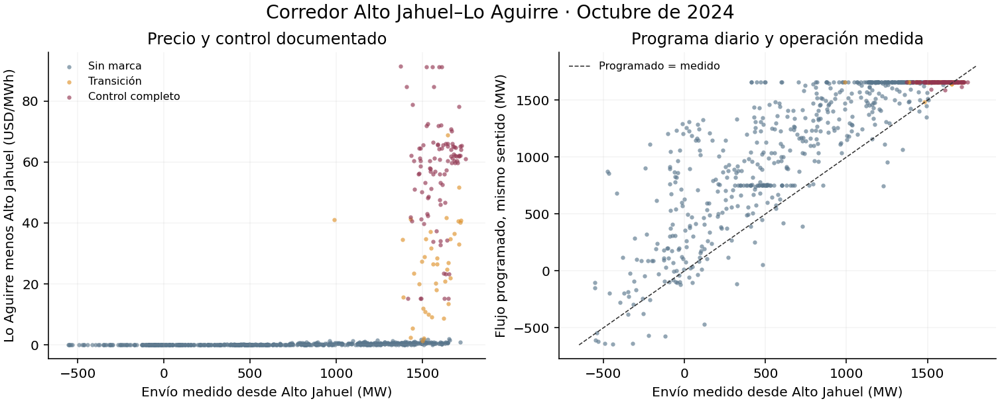

# Octubre de 2024. Despacho programado y operación observada de Alto Jahuel–Lo Aguirre

**Pregunta.** ¿Se generaliza a un mes el desacople observado el 7 de octubre? ¿Hasta dónde reproduce el programa diario el flujo y el estado operativo del corredor de 500 kV?

**Resultado.** La brecha media Lo Aguirre menos Alto Jahuel fue de **57,17 USD/MWh** durante las 98 horas completas con control de transferencia documentado y de **0,24 USD/MWh** en las 607 horas completas sin esa marca. Al comparar los dos estados dentro de una misma hora del reloj se conserva la separación. La programación del día anterior utilizó **1.660 MW** como límite del enlace equivalente en sentido Alto Jahuel → Lo Aguirre durante las 744 horas. La consigna efectiva aplicada en tiempo real sigue sin verificarse por hora.



## Diseño, cobertura y resultados

Se incluyeron consecutivamente los 31 días de octubre de 2024, el mes del piloto. Son 2.976 cuartos de hora, cuatro medidores y 744 horas completas. El par de días que motivó la investigación está incluido. Octubre constituye una ampliación del piloto dentro del mismo mes. La generalización a otras estaciones o topologías requiere períodos adicionales.

| Estado observado según la jerarquía definitiva del CMg | Horas | Envío medio desde Alto Jahuel (MW) | Brecha media (USD/MWh) | Brecha mediana (USD/MWh) |
|---|---:|---:|---:|---:|
| Control documentado los 60 minutos | 98 | 1.586,26 | 57,17 | 60,43 |
| Sin marca de ese control durante el bloque | 607 | 713,02 | 0,24 | 0,00 |
| Inicio o fin del control dentro de la hora | 39 | 1.554,56 | 26,01 | 26,63 |

En nueve horas del reloj aparecen ambos estados completos al comparar distintos días. El promedio de los nueve contrastes, ponderando cada hora por igual, es **+58,09 USD/MWh**. Al exigir al menos tres fechas por estado en cada hora quedan ocho comparaciones y el promedio es **+56,58 USD/MWh**. Esta brecha corresponde a los extremos del corredor de 500 kV. El contraste anterior de Las Canteras 110 kV respecto de Quillota 220 kV medía otro precio relativo. La zona de desacople y los precios publicados proceden del mismo proceso oficial de cálculo. Su concordancia caracteriza el régimen y por sí sola no identifica el efecto causal del control ni el de un centro de datos. [Resultados por hora del reloj](misma_hora.csv) · [Panel observado](horas.csv)

## Qué se recuperó de PLEXOS

Se recuperaron los 31 archivos oficiales de programación diaria, sus bases y sus soluciones. Para cada fecha se usó el primer día del horizonte, en horas locales de 00:00 a 23:00. El objeto agregado del modelo está orientado de Lo Aguirre a Alto Jahuel. Se invirtió el signo del flujo y del límite de importación para expresarlos en el sentido de envío que usan las mediciones. La propiedad horaria de límite de importación dio **1.660 MW en las 744 horas**. En las dos bases del piloto, los archivos de entrada de capacidades también registran −1.660 y +1.660. Los valores de la solución son del programa diario. Dividir el flujo real por ese límite solo daría una comparación con el programa. [Programas de operación del Coordinador](https://www.coordinador.cl/operacion/documentos/programas-de-operacion-2021/) · [Archivos y huellas de PLEXOS](fuentes_pcp.csv)

Como comprobación de lectura, se comparó el flujo horario de la solución binaria de PLEXOS con la fila del corredor en la hoja PROGRAMA de las 31 planillas PRG oficiales, con tolerancia absoluta de 0,00001 MW. Coincidieron las **744 de 744 horas**. Las dos publicaciones representan la misma programación. Para medir su desempeño se contrastó con la energía registrada por los medidores de los paños y con la jerarquía final de desacoples. [Archivos PRG verificados](fuentes_prg.csv) · [Serie programada y errores](programado.csv)

| Resultado del programa diario | Mes completo | Segunda quincena |
|---|---:|---:|
| Horas con flujo programado y medido | 744 | 384 |
| Error absoluto medio del flujo (MW) | 342,66 | 416,16 |
| Sesgo, programado menos envío medido (MW) | +321,73 | +405,22 |
| Horas completas comparables para el estado | 705 | 363 |
| Marca de congestión en el programa y control registrado | 95 | 49 |
| Marca de congestión en el programa y ausencia de ese control | 174 | 115 |
| Programa sin congestión y control registrado | 3 | 1 |
| Programa sin congestión y ausencia de ese control | 433 | 198 |

En el mes, el programa marcó congestión en el 96,9 % de las horas con control documentado (95/98). De las 269 marcas programadas en horas sin transición, 95 coincidieron con control documentado (35,3 %). El error absoluto medio de flujo fue 89,73 MW durante el control y 398,08 MW en horas sin esa marca. Los signos corresponden al envío desde Alto Jahuel. Los balances en los extremos y la representación de pérdidas del modelo pueden diferir. La discrepancia entre una restricción programada y una instrucción final también puede reflejar cambios de disponibilidad, demanda o despacho entre ambos momentos. La atribución a un mecanismo concreto queda abierta. [Cómputo de resultados](desempeno_PCP.csv)

**Lectura del par original.** Para las 05:00 del 7 y del 8, PLEXOS programó 1.660 MW y marcó congestión las dos veces. El envío medido fue 1.440,73 y 1.547,03 MW. La jerarquía final documentó control únicamente el día 7. El límite programado es una referencia recuperable y auditable. Faltan la consigna o inequación de seguridad aplicada en sala y la topología efectiva para reconstruir por qué se separaron las barras en una hora y se acoplaron en la otra. [Fuentes y mediciones del par original](../README.md)

## Referencias estadísticas para desarrollar el modelo

Se ajustaron dos reglas simples en las horas completas del 1 al 15 y se evaluaron en las del 16 al 31. La primera usa la frecuencia por hora del reloj. La segunda clasifica por un umbral de flujo medido que maximiza el promedio entre sensibilidad y especificidad en el ajuste. La partición es cronológica y exploratoria. Algunas fechas de octubre ya figuraban en el informe previo. La regla de flujo observa el envío realizado en la hora y sirve como diagnóstico contemporáneo. PLEXOS opera con información anterior al despacho.

| Regla | Horas de evaluación | Verdaderos positivos | Falsos positivos | Verdaderos negativos | Falsos negativos | Exactitud balanceada |
|---|---:|---:|---:|---:|---:|---:|
| Hora del reloj | 363 | 49 | 65 | 248 | 1 | 88,62 % |
| Flujo medido ≥ 1.404,51 MW | 363 | 49 | 60 | 253 | 1 | 89,42 % |

El umbral estadístico es un parámetro de clasificación aprendido en la primera quincena. El alcance físico del límite del programa y el significado operativo del umbral son diferentes. [Reglas y resultados](prueba.csv)

## Bitácora y reproducción

1. Descargar los ZIP definitivos diarios enlazados por el Coordinador. Extraer el precio en USD/MWh de ambas barras y los minutos de control del tramo en la hoja de jerarquía de desacoples. El código distingue las horas de transición.
2. Leer los cuatro paños físicos identificados en el piloto desde el ZIP mensual. Se comprobaron 11.904 observaciones de medidor, la unicidad, los cuatro intervalos por hora y la concordancia de hora local y UTC. Cada cuarto se convierte a MW medios a partir de sus kWh netos.
3. Leer propiedades horarias de la solución PLEXOS mediante los identificadores de objeto, propiedad, fase, posición binaria y fecha. Conservar ambos límites direccionales, el flujo y la marca horaria de congestión. Comparar por fecha y hora con las mediciones y la etiqueta de control definitivo.
4. Recalcular los conteos por régimen y los errores. Comprobar el flujo contra la planilla PRG diaria, conservar las tres listas de fuentes con sus SHA-256 y generar el gráfico. Las horas de transición entran en la prueba de flujo y se informan por separado para la comparación de estados.

Desde una copia de esta carpeta, con Python ≥3.11, pandas, NumPy, openpyxl y matplotlib, los siguientes comandos recrean el análisis. Los insumos grandes se descargan a un directorio temporal. El propio programa comprueba las huellas de los archivos usados en esta versión.

```bash
d=$(mktemp -d)
python descargar.py "$d/cmg"
curl -fLsS 'https://medidas.coordinador.cl/public/MEDIDAS%20TRANSFERENCIAS%20ECONOMICAS/2024/10_Octubre/Definitivo/1_Transferencia_Puntos_de_Medida_15MIN_CSV.zip' -o "$d/medidas.zip"
python octubre.py "$d/cmg" "$d/medidas.zip" fuentes_cmg.csv "$d/resultados"
python - "$d" <<'PY'
import csv, sys
from pathlib import Path
from urllib.request import urlretrieve
for tipo in ("pcp", "prg"):
    ruta = Path(sys.argv[1]) / tipo
    ruta.mkdir()
    with open(f"fuentes_{tipo}.csv") as f:
        for fila in csv.DictReader(f):
            urlretrieve(fila["zip"], ruta / f"{int(fila['dia']):02}.zip")
PY
python programa.py "$d/pcp" fuentes_pcp.csv "$d/resultados"
cp fuentes_prg.csv "$d/resultados/"
python comprobar.py "$d/resultados" "$d/prg"
for tabla in horas regimenes prueba programado desempeno_PCP misma_hora; do
  diff -u "$tabla.csv" "$d/resultados/$tabla.csv"
done
cp figura.py "$d/resultados/"
python "$d/resultados/figura.py"
```

## Decisión para el artículo

El mes aporta una referencia observable para el modelo de despacho y permite cuantificar dónde se equivoca la programación diaria. Para el próximo contraste conviene reservar un mes de otra estación antes de ajustar parámetros, recuperar las revisiones intradiarias o consignas de seguridad y evaluar flujo y brecha de precios en las mismas horas. El resultado económico de coordinación exige además una obra y fechas verificables, un perfil de carga y simulaciones con y sin ese refuerzo. Monetizar la brecha nodal multiplicándola por los MW del centro mezclaría diferencias de precio entre barras con el cambio en costo de operación del sistema.
