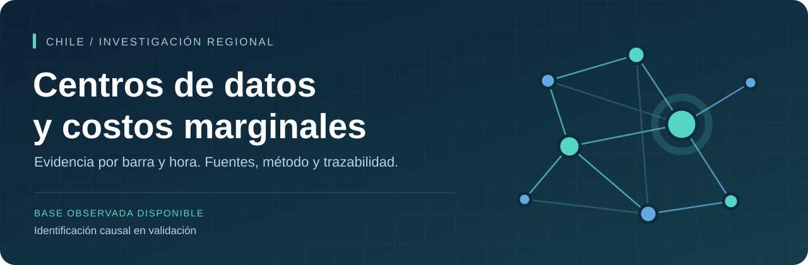

# Centros de datos y costos marginales en Chile

**Datos, código y trazabilidad del artículo:** *Entrada de centros de datos y diferenciales nodales de costo marginal: evidencia causal para Chile*.

[Descargar dataset](https://github.com/a-cartes/datacenter/releases/tag/v0.2.0) · [Guía 2020–2026](docs/ampliacion_2020_2026.md) · [Proceso](docs/proceso.md) · [Método](docs/metodologia.md) · [Reproducción](docs/ampliacion_2020_2026.md#reconstrucción-desde-la-versión-privada) · [Pendientes](ROADMAP.md)

El proyecto estudia cómo la entrada y expansión de centros de datos puede afectar las diferencias de costos marginales entre nodos eléctricos de Chile. La versión **v0.2.0** amplía la capa de precios desde el **1 de enero de 2020 hasta el 18 de septiembre de 2026**, último día publicado en la fuente definitiva consultada. La revisión de disponibilidad se hizo el 27 de septiembre de 2026.

**Estado científico:** datos observados y controles de calidad. La asignación de tratamientos, la vigencia de conexiones centro–barra y la conciliación horaria siguen en validación. Esta entrega no presenta efectos causales estimados.

**Etapa v8 construida:** [panel analítico y evidencia](docs/panel_causal_v8.md), con **142.151 filas diarias**, **4.756 mensuales**, matriz de **24 hitos**, **33 fuentes catalogadas**, protocolo registrado, Excel de revisión y [manuscrito en español con resumen en inglés](SOCHER_2026_v8_panel_causal/documentos/manuscrito_v8.md). La nueva homologación enlaza 53 de 58 etiquetas de agosto de 2023 sin modificar precios. Se acreditó la energización de Ascenty E53 el 5 de mayo de 2025 y su ruta nominal hacia Chacabuco 110 kV; sigue abierta la naturaleza de la carga y el contrafactual. No hay ATT habilitado y v0.2.0 permanece intacta.

**Descargas auditadas el 27/09/2026:** no se detectó truncación en las fuentes de precios utilizadas. Se revisaron 55 libros históricos y 28 originales modernos; tres libros recuperados desde descargas interrumpidas coinciden con nuevas descargas completas. La homologación adicional de agosto de 2023 quedó separada de v0.2.0 y se incorpora como metadatos en v8. [Resultado, evidencia y límites del control](docs/integridad_descargas_20260927.md).

**Resultado nuevo E53:** en la ventana declarada de 104 días previos y 90 posteriores, Chacabuco 110 sube **16,57 USD/MWh** y Quillota 110 sube **15,58**; el diferencial aumenta **0,99 USD/MWh**, frente a **0,24** en los primeros 28 días. Son cambios descriptivos, sin atribución causal. Se verificaron independientemente los 25 contrastes y se recuperaron 90.532 mediciones agregadas ET7, sin considerarlas consumo exclusivo de Ascenty. [Informe, figura, fuentes y reproducción](SOCHER_2026_v8_panel_causal/investigacion_e53_20260927/README.md). El Excel previo conserva su carácter de instantánea anterior a esta ampliación.

**Avance ODATA:** se recuperó la carta original del titular que declara inicio de operación de Lampa para el **1 de agosto de 2022**, junto con su comprobante SMA. Los precios históricos de Batuco tienen soporte común de 105 días previos y 90 posteriores, pero falta acreditar el empalme vigente, conciliar el inicio de octubre registrado por OGP y justificar la comparación causal. Se distinguen suministro inicial y conexión de alta tensión posterior; se documenta también por qué una solicitud de Alto Jahuel en 2024 no acredita entrada ese año. [Informe integrado y siguientes documentos necesarios](SOCHER_2026_v8_panel_causal/investigacion_odata_20260927/README.md). La revisión de literatura incorpora cuatro trabajos primarios de 2026. No se habilita un ATT ni se modifica v0.2.0.

| Entrega 2020–2026 | Dimensión verificada |
|---|---:|
| Observaciones de barra × fecha × hora publicada | **3.411.527** |
| Variables del CSV principal | **31** |
| Particiones de precios DEF integradas | **82**: 55 históricas y 27 modernas |
| Archivos CSV por año | **7** |
| Registros de medición a 15 minutos, en capa separada | **1.862.581** |
| Fuentes mensuales de mediciones | **40**, mayo de 2023–agosto de 2026 |

Se integraron todos los meses del período solicitado hasta el corte observado. Las 82 particiones corresponden a 81 meses calendario: julio de 2024 se divide entre dos regímenes de publicación, sin duplicar fechas. Eso no significa que todas las barras existan o tengan observaciones durante todo el período. Los [informes de cobertura](SOCHER_2026_v7_2020_2026/evidencia/Cobertura_por_mes_regimen.csv) describen días, barras, horas y vacíos. Las identidades publicadas y los 30 sockets candidatos **no equivalen a centros independientes**.

## Abrir los datos

En la [versión privada v0.2.0](https://github.com/a-cartes/datacenter/releases/tag/v0.2.0) se encuentran:

- **Dataset_precios_barra_hora_2020_2026.csv.gz**: CSV completo comprimido; al descomprimir contiene exactamente el mismo CSV verificado.
- **CSV_por_anio_2020_2026.zip**: siete CSV para abrir cada año por separado en Excel, junto con el diccionario y las coberturas.
- **Dataset_precios_barra_hora_2020_2026.parquet**: copia por columnas para R o Python.
- **Capas_complementarias_2020_2026.zip**: mediciones horarias y de 15 minutos separadas, y precios preliminares de septiembre, con sus guías.
- **Insumos_reproduccion_2020_2026.zip**: particiones y metadatos congelados para reconstruir la entrega.
- **SHA256SUMS.txt** e informes de verificación para comprobar la integridad de las descargas.

El CSV completo excede la capacidad de filas de una hoja de Excel. Cada CSV anual cabe dentro de ese límite. En Excel, importar desde **Datos → Desde texto/CSV**, con UTF-8 y separador coma; los decimales usan punto. El repositorio y sus archivos son privados y requieren acceso autorizado.

Esta versión tiene 31 columnas de precios, referencias y trazabilidad. La anterior tenía 66 columnas en un panel de trabajo que reunía más capas. No son dos conversiones del mismo archivo: **v0.2.0 amplía el tiempo y mantiene consumo y evidencia de eventos separados hasta validar sus enlaces**. La [versión v0.1.0](https://github.com/a-cartes/datacenter/releases/tag/v0.1.0), con 178.016 filas de 2024, CSV y Excel, permanece disponible.

## Del original al dato analizable

La documentación adapta **W3C PROV-DM** para enlazar fuentes, transformaciones y productos. Es una forma de organizar la procedencia, no una teoría nueva ni una certificación. El [registro del proceso](docs/proceso.md) y la [guía ampliada](docs/ampliacion_2020_2026.md) explican los problemas que cambian la interpretación:

| Problema observado | Tratamiento en la base |
|---|---|
| Cambio de publicación el 15 de julio de 2024 | Regímenes separados; se preservan ambas convenciones horarias. |
| Identidades, tensiones y códigos cambian | Identificador mensual y campos literales; no se inventa continuidad física. |
| Archivo nacional descargado parcialmente | Sólo se recupera un libro interno si está completo y verifica tamaño, CRC y su estructura; el contenedor queda marcado como incompleto. |
| DEF, PRE y reliquidaciones difieren | Versión preservada; PRE separado; no se afirma que DEF sea la última reliquidación. |
| Cuatro intervalos de 15 minutos forman la hora moderna | Precio horario válido sólo con 0, 15, 30 y 45 presentes. |
| Diferencias entre octubre de 2023 y una exportación antigua | Se conservan fuente, magnitudes y celdas contrastadas; no se rellenan huecos mezclando versiones. |
| Millones de filas y riesgo de pérdida al exportar | Comparación de las 31 columnas CSV/Parquet, nulos incluidos; hashes y concatenación anual. |

Los precios originales seleccionados de la base anterior coinciden en sus **178.016 filas** con la nueva extracción. La asignación de códigos se vuelve a evaluar con la homologación exacta de cada mes.

## Reproducir y revisar

La [guía de reproducción](docs/ampliacion_2020_2026.md#reconstrucción-desde-la-versión-privada) distingue dos alcances:

1. **Reconstruir exactamente la entrega** desde las particiones archivadas y comprobadas de la versión privada.
2. **Volver a adquirir y extraer los originales**, con los scripts y catálogos. El proveedor puede actualizar una fuente; la reproducción exacta exige conservar la instantánea original. Algunas descargas históricas requieren la interfaz del portal.

La [verificación local completa](SOCHER_2026_v7_2020_2026/evidencia/Verificacion_entrega.json) compara todas las filas y columnas. La concatenación de los siete CSV anuales y la descompresión de gzip reproducen el CSV principal byte por byte. Las pruebas de corrupción, referencias ambiguas y archivos alterados están conservadas en el código.

**Reconstrucción remota completada en Linux:** [GitHub Actions](https://github.com/a-cartes/datacenter/actions/runs/36295132374). Recuperó las 3.411.527 filas con el mismo SHA-256 del CSV publicado y aprobó las pruebas de referencias y detección de archivos alterados. [Informe conservado](docs/evidencia-v0.2.0/CI_reproduccion.json). También se preserva la [reconstrucción local desde el paquete](docs/evidencia-v0.2.0/Local_reproduccion.json).

El [diccionario](SOCHER_2026_v7_2020_2026/evidencia/Diccionario_precios.csv), las [fuentes](SOCHER_2026_v7_2020_2026/evidencia/Fuentes_precios.csv) y los [faltantes](SOCHER_2026_v7_2020_2026/evidencia/Faltantes_precios_detalle.csv) permiten auditar el resultado sin descargar todos los originales nacionales.

## Límites de interpretación

- El costo marginal nodal no es la tarifa pagada por un centro de datos.
- Quillota 110 y 220 son referencias descriptivas; su diferencia de precio no acredita por sí sola un efecto causal.
- Los precios históricos conservan horas 1–25 y los modernos HRA 0–24; todavía no existe una conciliación validada con las mediciones en UTC.
- El agregado HT1 + HT2 no certifica el consumo total de un campus. D y R permanecen separados.
- Una fecha prevista, una energización y una entrada operacional son hitos diferentes. La primera medición disponible no es una inauguración.
- Los vacíos permanecen vacíos; no se convierten en cero ni en unidades nunca tratadas.

El [modelo metodológico](docs/metodologia.md) presenta los supuestos para ATT, DiD escalonado, estudio de eventos y exposición a otros centros. La [hoja de ruta](ROADMAP.md) separa las tareas cumplidas de las pendientes.

## Research overview

This project builds a traceable electricity-node dataset to study the effects of data-center entry and expansion on nodal marginal-cost differentials in Chile. Version 0.2.0 covers published definitive prices from January 2020 to 18 September 2026, preserving source versions, historical identities and time labels. Measurement layers remain separate until electrical links and time conventions are validated. No causal effect is claimed at this stage.

## Autoría y citación

Alan Cartes Fica · Universidad del Bío-Bío.

[CITATION.cff](CITATION.cff) describe este recurso de investigación, no un artículo ya publicado. Cite la versión específica y las fuentes primarias del Coordinador Eléctrico Nacional. Las condiciones de reutilización están en [REUSE.md](REUSE.md).
