<p align="center"></p>

# Centros de datos y costos marginales en Chile

**Datos, código y trazabilidad del artículo:** *Entrada de centros de datos y diferenciales nodales de costo marginal: evidencia causal para Chile*.

[Datos](docs/datos.md) · [Proceso y evidencia](docs/proceso.md) · [Modelo metodológico](docs/metodologia.md) · [Decisiones](docs/decisiones.md) · [Reproducir](docs/reproducir.md) · [Hoja de ruta](ROADMAP.md)

Este proyecto estudia cómo la entrada y expansión de centros de datos puede afectar las diferencias de costos marginales entre nodos eléctricos de Chile. El trabajo reúne evidencia de precios, mediciones y conexiones para construir una muestra que permita evaluar esa pregunta con métodos de panel y evaluación de impacto.

**Estado de la investigación:** base observada integrada. Las fechas de tratamiento, los vínculos eléctricos vigentes, los comparadores y la exposición a otros proyectos siguen en validación. Esta versión no presenta efectos causales estimados.

| Base disponible | Dimensión |
|---|---:|
| Observaciones de barra y hora | **178.016** |
| Variables del panel | **66** |
| Identidades históricas de barra | **83** |
| Hitos documentales registrados | **24** |
| Registros de medición a 15 minutos | **67.384** |

Las identidades de barra no equivalen a centros independientes. La cobertura de precios incluye febrero, abril, mayo, junio y del 1 al 14 de julio de 2024.

## Una investigación que se puede auditar

El proyecto adapta el modelo de procedencia **W3C PROV-DM** a su documentación: fuentes identificadas, operaciones registradas, resultados verificables y decisiones revisables. Cada etapa enlaza la evidencia disponible. La adaptación organiza el trabajo; no se presenta como una teoría nueva ni como certificación de conformidad con el estándar.

| Quiero revisar… | Punto de entrada |
|---|---|
| Cómo se pasó de archivos dispersos al panel | [Ocho etapas y sus controles](docs/proceso.md) |
| Qué dificultades surgieron y cómo se resolvieron | [Problemas, decisiones y evidencia](docs/proceso.md#dificultades-que-cambian-la-interpretación) |
| Qué reglas se aplicaron y qué falta resolver | [Registro de diez decisiones](docs/decisiones.md) |
| Qué modelo se plantea y qué supuestos requiere | [Datos, ATT, dinámica y exposición](docs/metodologia.md) |
| Cómo repetir el trabajo en otro entorno | [Instrucciones y alcance de la reproducción](docs/reproducir.md) |
| Qué se verificó al instalar y ejecutar desde cero | [Auditoría en un entorno virtual nuevo](docs/auditoria.md) |

Las dificultades se documentan mediante problemas observables: identidades históricas, vigencia eléctrica, reloj, polaridad, faltantes y exportación de grandes tablas. Se distingue lo resuelto de lo pendiente y la integridad computacional de la identificación causal.

**Prueba local completada:** instalación en un entorno virtual nuevo, once pasos ejecutados, doce tablas verificadas y exportaciones completas contrastadas. El CSV reconstruido es idéntico al original. La [evidencia conservada](docs/auditoria.md) delimita esta comprobación al mismo equipo y a los extractos archivados.

## De las fuentes al artículo

```mermaid
flowchart LR
    A[Fuentes y extractos preservados] --> B[Identidad de barras y reloj]
    B --> C[Panel observado]
    C --> D[Controles de calidad]
    D --> E[CSV, Excel y Parquet]
    E --> F[Validación de eventos y suministro]
    F --> G[Muestra para evaluación causal]
    G --> H[Artículo y SOCHER 2026]
    classDef disponible fill:#e5f4f2,stroke:#16827d,color:#123b3a;
    classDef pendiente fill:#fff4df,stroke:#bf8735,color:#63451b;
    class A,B,C,D,E disponible;
    class F,G,H pendiente;
```



El proceso de esta versión reconstruye la base a partir de extractos preservados. La descarga y extracción completa de todos los originales es una etapa anterior que todavía no se reproduce automáticamente desde este repositorio.

## Empezar

Para revisar el contenido, comienza por la [guía de datos](docs/datos.md) y el [diccionario de las 66 variables](SOCHER_2026_dataset/documentacion/diccionario_panel.csv). Para reconstruirlo, sigue las [instrucciones de reproducción](docs/reproducir.md).

Los archivos de Excel y CSV sin comprimir son productos de entrega. Se generan en `artifacts/` y se distribuyen asociados a una versión; no se incluyen copias sucesivas de esos archivos voluminosos en el historial de código.

## Organización

```text
docs/                         Guías de lectura, método y reproducción
scripts/                      Ejecución y comprobaciones del repositorio
SOCHER_2026_dataset/           Constructores, contratos, diccionarios y controles
SOCHER_2026_v2/                Insumos documentales preservados
SOCHER_2026_v3/                Extractos e insumos de mediciones y eventos
SOCHER_2026_v4/                Insumos de contraste y red
SOCHER_2026_v6_multicentros/    Extracción identificada de precios y mapeo
artifacts/                    Entregas regeneradas, fuera del historial Git
```

Los nombres de las carpetas anteriores conservan la procedencia de los insumos; cada una contiene únicamente el material necesario para esta reconstrucción y la documentación incluida en el inventario.

## Criterios de interpretación

- Un valor desconocido permanece vacío; no se convierte en cero ni en “nunca tratado”.
- Una fecha prevista, una energización y una entrada operacional son hitos distintos.
- Compartir una barra no duplica el precio ni crea nuevas unidades independientes.
- Los indicadores de calidad del precio no validan la comparación causal.
- Los diferenciales respecto de Quillota son resultados relativos descriptivos; no son tarifas pagadas por los centros.

El [contrato para la estimación](SOCHER_2026_dataset/documentacion/Contrato_para_estimacion.md) documenta estas decisiones y los requisitos que debe cumplir la muestra.

## Research overview

This project assembles a traceable electricity-node panel to study whether data-center entry and expansion affect nodal marginal-cost differentials in Chile. The current version documents observed prices, measurement records and project evidence. Treatment timing, time-consistent electrical links, comparison units and network exposure remain under validation. No causal effect is claimed at this stage.

## Autoría y citación

Alan Cartes Fica · Universidad del Bío-Bío.

Los metadatos de esta base están en [CITATION.cff](CITATION.cff). Corresponden al recurso de investigación, no a un artículo ya publicado. Las condiciones de publicación y reutilización se documentan en [REUSE.md](REUSE.md).
