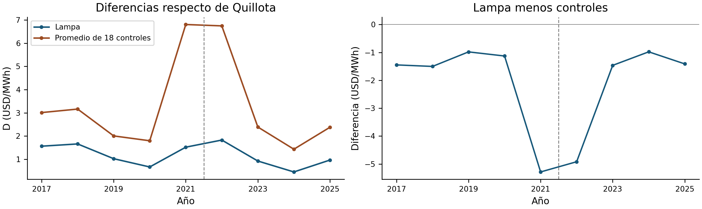
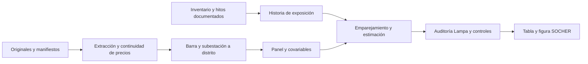

# Centros de datos y costos marginales eléctricos en la Región Metropolitana

Repositorio de datos, código y evidencia del estudio **¿Dónde se conecta la inteligencia artificial? Centros de datos y costos marginales eléctricos en la Región Metropolitana ante el horizonte 2030**.

La versión vigente es el **cierre analítico para SOCHER 2026**, con precios 2017–2025, inventario trazable y documentación eléctrica por etapa. Establece una línea de base ante la expansión digital: **no demuestra un incremento causal robusto de precios ni contiene una simulación contrafactual de 2030**.

[Reproducir el cierre](SOCHER_2026_RM/README.md) · [Manuscrito](SOCHER_2026_RM/manuscrito/Resumen_extendido_Alan_Cartes.pdf) · [Método](SOCHER_2026_RM/documentacion/METODO.md) · [Mapa de resultados](SOCHER_2026_RM/documentacion/MAPA_RESULTADOS.md) · [Historia y decisiones](SOCHER_2026_RM/documentacion/TRAZABILIDAD.md)

## Resultados de esta versión

| Resultado | Valor o alcance |
|---|---|
| Inventario | 63 registros de instalaciones o etapas, 138 hitos, 65 fuentes |
| Muestra principal | 3 distritos tratados, 18 controles, 189 observaciones distrito-año |
| Estimación histórica principal | 1,05263 USD/MWh; sensible a Lampa y a la evolución previa de los controles |
| Misma muestra con fecha anterior de Lampa | 1,01514 USD/MWh |
| Exclusión de Lampa | 0,03273 USD/MWh |
| Contraste descriptivo con todo el período previo | −0,08663 USD/MWh |
| Diagnóstico de conexiones | Apertura, conexión y utilización de capacidad son hitos distintos |
| Escala 2030 | 5,455728–9,09288 TWh/año bajo supuestos explícitos; sensibilidad, no impacto de precios estimado |

La [nota metodológica](SOCHER_2026_RM/documentacion/METODO.md) explica las dos ponderaciones, los intervalos convencionales, el test previo singular y los límites de comparación con Virginia. La [Tabla 1 reproducida](SOCHER_2026_RM/evidencia/tabla_1.csv) conserva la sensibilidad a fechas y exclusión de Lampa.



La entrega fija [v0.3.0](https://github.com/a-cartes/datacenter/tree/v0.3.0) cuenta con **35 comprobaciones científicas superadas en Mac y Linux**. Consulte los [informes de reproducción](SOCHER_2026_RM/evidencia/README.md).

## Datos efectivamente encontrados y revisados

Auditoría local del **11 de octubre de 2026**, inicio de la investigación de consumo efectivo y exposición zonal. La disponibilidad comprobada se refiere al archivo de investigación; los originales voluminosos no están todos incluidos en GitHub. Las filas describen fuentes que pueden solaparse: sus registros y mediciones no deben sumarse entre sí.

| Recurso | Disponibilidad comprobada | Uso y límite concreto |
|---|---|---|
| Originales de demanda | 653 archivos, 26,54 GB; todos existen y conservan el tamaño inventariado | Reextracción selectiva de meses/puntos; no hace falta volver a descargarlos masivamente. Incluyen familias, versiones y archivos que no deben sumarse. |
| Retiros comerciales SIP | 27.425 registros cliente–barra–hora; 21 pares y 11 etiquetas empresariales; 89 fechas entre diciembre de 2023 y julio de 2026 | 18.053 registros no ambiguos con valor; 9.372 ambiguos. Son días muestreados, generalmente 5, 15 y 25, no series mensuales completas. Las etiquetas no equivalen a 11 operadores independientes. |
| Mediciones físicas v7 | 1.862.581 registros de 15 minutos, 30 sockets candidatos, mayo de 2023–agosto de 2026 | Se localizaron las tablas en Descargas y se verificó su identidad con cinco hashes publicados. Los sockets incluyen tránsito, transformadores y extremos de equipos: no representan 30 centros. |
| Las Canteras HT1+HT2 | 21.912 horas por etiquetas y 913 fechas locales, febrero de 2024–agosto de 2026, con abril de 2024 ausente | Agregado recalculado desde ambos HT y conciliado con la tabla anterior; error numérico máximo menor a 2×10⁻¹² kWh. Excluye HT3 y líneas de tránsito. |
| Panamericana | Piloto octubre de 2023–marzo de 2024: 4.392 horas completas, cuatro canales de transformadores | Se reprodujo la frontera D−R heredada. Mide el suministro seleccionado, compartido; falta aislar o acotar la carga del centro. |
| Historia Chacabuco | 24 puntos, 105 meses distintos entre enero de 2018 y septiembre de 2026, cobertura desigual por punto | Aporta antecedentes para examinar etapas y cambios de rotulado. Se mantienen los canales separados. |
| Antecedentes Dataluna | 20.447 valores horarios 2020–2022, 744 en enero de 2023 y 8.548 observaciones hora×canal de febrero–abril de 2023 | Existen tablas, verificadas por hash; unidad/signo y continuidad de las primeras fuentes pendientes de homologación. |
| Precios y red | 117 archivos horarios de precios; panel RM previo; 1.939 aristas y 2.482 fichas de transformadores en los catálogos locales | Disponibilidad no equivale a cobertura homogénea. Hay parámetros de impedancia/capacidad, con distintos estados de certificación; falta una red histórica validada. |
| Inventario y conexión | 63 registros de instalaciones, etapas y proyectos; cartas y matriz de conexiones del cierre anterior | Se generó una tabla de disponibilidad para los 63 registros. La búsqueda por operador produce candidatos, no asignaciones certificadas de carga a cada edificio. |

Fuentes y comprobaciones: [informe de disponibilidad](Investigacion_carga_zonal/INFORME_INICIAL.md), [resumen recalculado](Investigacion_carga_zonal/resultados/20261011_inventario_v2/resumen_auditoria.json) y [verificación de las mediciones](Investigacion_carga_zonal/resultados/20261011_inventario_v2/comprobacion_mediciones_legacy.json).

La etapa posterior está documentada en la [conciliación de Las Canteras y ODATA](Investigacion_carga_zonal/INFORME_CONCILIACION_20261011.md). Consulte la [bitácora](Investigacion_carga_zonal/BITACORA.md), el [control de cambios](Investigacion_carga_zonal/CONTROL_CAMBIOS.csv) y las [instrucciones de reproducción](Investigacion_carga_zonal/REPRODUCCION.md). Los diagnósticos nuevos se conservan por separado del cierre SOCHER v0.3.0.

## Ejecutar el análisis

Desde una copia de este repositorio, con Python 3.13 y R disponibles:

```bash
python3 -m venv .venv-socher
source .venv-socher/bin/activate
python -m pip install -r SOCHER_2026_RM/requirements-lock.txt
Rscript SOCHER_2026_RM/scripts/instalar_R.R
python SOCHER_2026_RM/scripts/reproducir.py
```

El programa comprueba hashes, reconstruye muestras y emparejamiento, ejecuta las regresiones, regenera la figura y contrasta los resultados con referencias congeladas. Publica un informe verificable en `SOCHER_2026_RM/salidas/reproduccion/verificacion.json`. No requiere credenciales ni conexión a internet después de instalar dependencias. Se conservan los [resultados de la verificación local](SOCHER_2026_RM/evidencia/verificacion_local.json) y existe un [flujo de comprobación en GitHub Actions](.github/workflows/socher-rm.yml).

La reproducción comienza en **paneles derivados**, no en una nueva descarga de todos los originales. La [guía de fuentes](SOCHER_2026_RM/documentacion/FUENTES_Y_RECONSTRUCCION.md) detalla lo incluido, los manifiestos, los programas de extracción y las tareas manuales necesarias para ese alcance adicional.

## El trabajo detrás de los resultados



- [Decisiones fechadas y revisiones posteriores](SOCHER_2026_RM/archivo/documentacion/REGISTRO_DECISIONES.md).
- [Validación de la medida eléctrica y cambios de publicación](SOCHER_2026_RM/archivo/documentacion/VALIDACION_MEDIDA.md).
- [Inventario de instalaciones y fuentes](SOCHER_2026_RM/datos/instalaciones/instalaciones.csv).
- [Matriz de conexiones y potencia](SOCHER_2026_RM/referencia/cierre_socher_20261009/matriz_conexiones_potencias.csv).
- [Diagnóstico de Lampa y de los controles](SOCHER_2026_RM/referencia/cierre_socher_20261009/INFORME_CIERRE.txt).
- [Comparabilidad del diseño con Virginia](SOCHER_2026_RM/referencia/cierre_socher_20261009/correspondencia_virginia.csv).
- [Bases PET26 y viabilidad de la siguiente etapa](SOCHER_2026_RM/archivo/prospectiva_documentacion/INFORME_VIABILIDAD.md).

## Investigación anterior y siguientes etapas

Las carpetas `SOCHER_2026_dataset` y v2–v8 se conservan como antecedentes. La [portada histórica de v8](README_historico_v8.md) documenta aquella etapa 2020–2026; no es el estado vigente del resumen RM. Las versiones publicadas v0.1.0 y v0.2.0 mantienen sus archivos. No se reescribe el historial ni se mezclan automáticamente sus muestras con el cierre 2017–2025.

La [hoja de ruta](ROADMAP.md) separa esta línea de base de la simulación de red pendiente y de la futura evaluación causal con retiros medidos por instalación. Este repositorio no acredita aceptación en SOCHER ni publicación en una revista.

## Autoría y citación

**Alan Cartes Fica, Ricardo Troncoso y Rodrigo Romo — Universidad del Bío-Bío, Chile.** Correspondencia: alancartes@outlook.com.

Use [CITATION.cff](CITATION.cff), identifique la versión o el commit consultado y cite las fuentes primarias correspondientes. El [registro de cambios](CHANGELOG.md) permite distinguir entregas. Las [condiciones de reutilización](REUSE.md) distinguen el trabajo propio de las fuentes de terceros.
