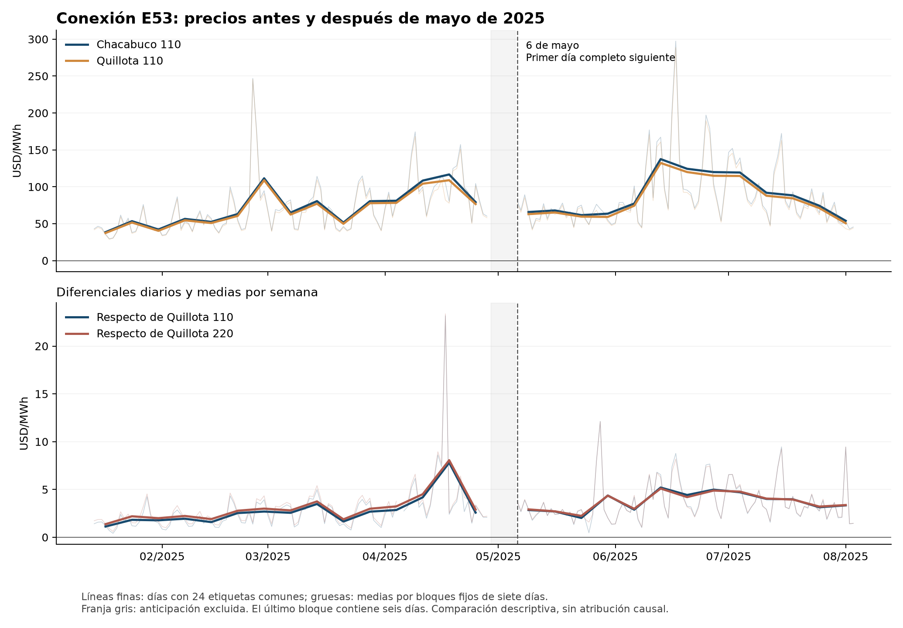

# E53: primer resultado cuantitativo del episodio

27 de septiembre de 2026. Este estudio de caso amplía v8 y conserva intactos la base v0.2.0, el protocolo general y la matriz publicada. La conexión E53 de Ascenty fue energizada el **5 de mayo de 2025**. El resultado verificable es una variación del precio relativo considerablemente menor que la del precio bruto; todavía no es una estimación del efecto de esa conexión.

## Resultado de precios

Ventana fijada: 14 de enero–28 de abril de 2025 frente a 6 de mayo–3 de agosto. Se excluyen siete días de anticipación y el 5 de abril, que tiene 25 etiquetas; quedan **104 días previos y 90 posteriores** con 24 etiquetas comunes. Cada día válido pesa lo mismo.

| Serie | Antes | Después | Cambio |
|---|---:|---:|---:|
| Precio Chacabuco 110 kV | 71,96 | 88,53 | +16,57 |
| Precio Quillota 110 kV | 69,21 | 84,79 | +15,58 |
| Diferencial Chacabuco–Quillota 110 | 2,75 | 3,74 | **+0,99** |
| Diferencial Chacabuco–Quillota 220 | 3,04 | 3,75 | **+0,72** |

Todos los valores están en USD/MWh. La mayor parte del aumento bruto también aparece en las referencias. El residuo relativo no se atribuye automáticamente a E53: faltan un contrafactual defendible y una medición del cambio de carga exclusivo de la conexión.

| Sensibilidad declarada | Cambio frente a Quillota 110 | Cambio frente a Quillota 220 |
|---|---:|---:|
| 90 días posteriores | +0,994 | +0,716 |
| Primeros 28 días | +0,237 | +0,017 |
| Anticipación de 0 días | +0,981 | +0,714 |
| Anticipación de 14 días | +0,982 | +0,706 |
| Sin 25–26 de febrero en el período previo | +0,990 | +0,712 |

En los primeros 28 días el precio bruto de Chacabuco **disminuye 7,23 USD/MWh** frente a la media previa. Por tanto, horizonte de evaluación y referencia cambian sustancialmente la descripción. No se publican p-valores, intervalos de confianza causales ni un efecto cero: la identificación permanece abierta.



[Todas las cifras y escenarios](analisis/resultados/contrastes_descriptivos.csv) · [Datos diarios con exclusiones](analisis/resultados/episodio_diario_completo.csv) · [Adenda previa al cálculo](analisis/LEEME_adenda.md) · [Verificación independiente](diseno/verificacion_contrastes.json).

## Qué aportó la investigación

1. **Enlace contemporáneo de precios.** La ruta nominal E53–BP7 de 23 kV–T7–BP1 de 110 kV se enlaza con `CHACABUCO_____110`, `ID_INFO=703`. La identidad del precio en la ventana 2025 se comprobó en las filas horarias originales. No se equipara BP7 con la barra CMg de 23 kV ni se afirma operación invariable de todos los interruptores.
2. **Consumo anterior y fases distintas.** La documentación ambiental y operativa confirma suministro previo del campus. La conexión de 2025 no acredita por sí misma una primera entrada de demanda. Chile 2/T10 y E53 siguen separados mientras falte el documento que los vincule; los nombres comerciales y las etapas ambientales no son intercambiables.
3. **Medición nueva recuperada sin volver a descargar la historia.** Se extrajeron **90.532 registros de 15 minutos** de `CHCABUCO_023_ET7_CHL`, entre enero de 2024 y agosto de 2026. Marzo de 2025 está ausente. ET7 no es un medidor exclusivo acreditado de Ascenty; sus canales D/R se mantienen separados y no se enlazan por hora con precios.
4. **Concurrencias documentadas.** Se registraron el apagón de febrero, fallas y maniobras de abril y julio. Se conservan en la principal; únicamente febrero tiene una exclusión de sensibilidad fijada antes del cálculo. Su existencia no prueba que expliquen el resultado, pero impide ignorar el entorno operativo.

El canal D de ET7 promedia 17,00 MW en los **74 de 105 días previos disponibles** y 19,40 MW en los 90 posteriores; en los primeros 28 posteriores promedia 17,19 MW. Son promedios de intervalos observados, no medias de una muestra idéntica a la de precios. **La falta de marzo y el carácter agregado del punto de medida impiden interpretar la diferencia como demanda nueva de E53.** Las energías originales están en kWh por intervalo de 15 minutos: MW medios = kWh/250.

## Alcance y siguiente contraste científico

La pregunta viable a examinar es la respuesta **relativa a una conexión eléctrica documentada**, distinta del efecto de primera entrada de un centro de datos. No requiere afirmar que toda la red restante sea no expuesta, pero sí justificar la evolución del diferencial en ausencia de E53 y las perturbaciones concurrentes. Una respuesta de Quillota formaría parte del parámetro relativo, en lugar de presumirse cero.

Antes de atribuir el cambio se necesitan la configuración y finalidad efectiva de E53, su correspondencia con el suministro previo y un argumento de comparación respaldado por la operación de la red. Los anexos públicos de las cartas se comprobaron y figuran expirados; esa limitación queda documentada. La falta de esos antecedentes no se reemplaza por seleccionar fechas o barras que produzcan significación.

## Reproducibilidad

Desde la raíz del proyecto o repositorio, con el panel diario v8 disponible en CSV o gzip:

```bash
python SOCHER_2026_v8_panel_causal/investigacion_e53_20260927/analisis/analizar_episodio.py
```

La [configuración](analisis/adenda_01.json) se guardó antes del cálculo específico, con conocimiento previo de los descriptivos generales declarado; **no es un prerregistro prospectivo**. El programa comprueba su panel por SHA-256, las firmas de etiquetas, los códigos y la identidad aritmética entre niveles y diferenciales. Conserva las 202 fechas de la ventana completa y reporta todos los escenarios.

La reproducción independiente reconstruye **los 25 contrastes** desde precios horarios originales de 2025, utilizando las filas de cada referencia y sin reutilizar el panel diario ni los diferenciales precalculados. La discrepancia máxima es inferior a `5e-11` USD/MWh, atribuible al redondeo del CSV derivado. Es una comprobación computacional independiente dentro del proyecto, no revisión externa de otro investigador.

Las carpetas `identidad/`, `diseno/` y `mediciones/` conservan fuentes, localizadores, scripts y verificaciones. La extracción ET7 necesita los ZIP definitivos nacionales ya conservados en v7; los extractos nuevos incluidos permiten repetir sus agregaciones sin descargar esos originales. El Excel previo de revisión v8 es una instantánea anterior a esta ampliación; este informe y el manuscrito incorporan el episodio nuevo.

[Identidad y suministro anterior](identidad/MEMO_identidad_carga.md) · [Diseño, concurrencias y verificación independiente](diseno/nota_diseno_e53.md) · [Alcance y reproducción de mediciones](mediciones/README_mediciones_E53.md).
