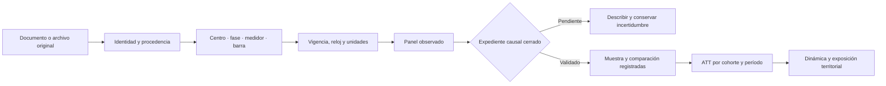

# De la evidencia documental al efecto causal

[Inicio](../README.md) · [Datos](datos.md) · [Reproducción](reproducir.md) · [Referencias](referencias.md)

> **Estado al 27/09/2026:** v8 está construida desde v0.2.0 (3.411.527 precios), con 142.151 filas diarias y 4.756 mensuales. El [protocolo registrado v8](../SOCHER_2026_v8_panel_causal/documentos/protocolo_previo_v8.md) y su [configuración](../SOCHER_2026_v8_panel_causal/documentos/protocolo_config.json) fijan las decisiones operativas vigentes. Hay 24 hitos documentales y ningún evento causal habilitado. Las ecuaciones explican el diseño, no representan efectos estimados.

## 1. Pregunta, alcance y aporte verificable

¿Cómo cambia el diferencial de costo marginal de una barra cuando entra o se amplía un centro de datos vinculado a ella, y cómo se distribuye ese cambio entre otros nodos de la red chilena?

La contribución que se busca es relacionar una intervención localizada con la distribución territorial de sus efectos eléctricos. Para ello se necesita demostrar qué instalación cambió, cuándo lo hizo, a qué barra estaba conectada y qué comparación aproxima su evolución sin esa intervención. Disponer de muchas horas de precios no resuelve esas cuatro preguntas.

Este protocolo combina una **capa de medición y enlace** con una **capa de identificación causal**. Su valor metodológico reside en hacer auditable el paso entre ambas. No se presenta como una teoría nueva ni se incorporan herramientas matemáticas sin un mecanismo contrastable. La organización en Parquet, CSV y Excel facilita la conservación y revisión de datos; no identifica por sí misma un efecto económico.

## 2. Modelo de medición y construcción del panel

### Unidades distintas, claves distintas

| Símbolo | Entidad | Regla de identificación |
|---|---|---|
| $c$ | Campus o establecimiento candidato | `centro_id` y `campus_grupo_id`; no equivale necesariamente a un establecimiento independiente |
| $f$ | Fase, ampliación o cambio de suministro | Se conserva dentro de la historia del campus; no se cuenta automáticamente como otra entrada |
| $m$ | Medidor o punto de medida | Identidad, canal, unidad y polaridad documentados |
| $b$ | Identidad histórica de barra de precios | `barra_id`; cambios de código no se fusionan sin acreditar continuidad |
| $t$ | Período de publicación del precio | Fecha y `hora_etiqueta`, conservadas como se publicaron |
| $\tau$ | Intervalo físico de tiempo | Se utiliza para enlaces solo después de conciliar UTC, zona local e inicio/final del intervalo |

La fila del panel es **barra histórica × fecha × etiqueta horaria** y su clave es `observacion_id`. El precio de una barra que abastece a varios centros aparece una sola vez. Duplicarlo por centro produciría una multiplicación artificial de observaciones y de precisión.

Formalmente, cada resultado derivado debe admitir una reconstrucción:

$$
\mathcal{D}^{(v)}=\mathcal{T}_{\theta^{(v)}}\left(\mathcal{F}^{(v)},\mathcal{L}^{(v)}\right),
$$

donde $\mathcal{F}^{(v)}$ es el conjunto de archivos identificados por su contenido, $\mathcal{L}^{(v)}$ es el registro de enlaces y decisiones, y $\mathcal{T}_{\theta^{(v)}}$ es la transformación con código, reglas y entorno registrados para la versión $v$. Esta expresión describe el proceso de construcción; no constituye un estimador causal. Los contratos y controles verifican claves, esquemas, conteos, procedencia y conservación de valores. Una huella digital acredita identidad de contenido, no veracidad del hecho documentado.

### Enlace con vigencia

La cadena que se debe acreditar es **campus → fase → punto de medida → instalación eléctrica → barra de precios**, con las fechas aplicables a cada tramo. La homologación de una barra en julio de 2024 no acredita automáticamente un vínculo operativo en otro año.

Se propone representar cada vínculo validado mediante:

$$
A_{cfmb}(\tau)=\mathbf{1}\{\text{vínculo acreditado y vigente en }\tau\}.
$$

El indicador se evalúa únicamente cuando su expediente permite distinguir vínculo vigente y no vigente. Un enlace desconocido se conserva como **NA**, nunca como cero. Cada arista requiere fuente, localizador, intervalo de vigencia, alcance y motivo de aceptación. Si existe reparto de carga entre barras, el coeficiente de asignación debe estar documentado; no se distribuye en partes iguales por defecto. Actualmente esta matriz validada no está construida.

### Resultado y referencia

El resultado principal candidato es el diferencial respecto de Quillota 110 kV; Quillota 220 kV se conserva como alternativa predefinida:

$$
Y^{(r)}_{bt}=P_{bt}-P_{rt},\qquad r\in\{\text{Quillota 110},\text{Quillota 220}\}.
$$

Ambos precios deben corresponder a la misma etiqueta y régimen de publicación. La unidad es **USD/MWh**. Las filas del propio nodo de referencia se excluyen de la muestra de diferenciales de análisis, pues su diferencia consigo mismo es mecánicamente cero. Las marcas `par_precio_estricto_q110/q220` describen calidad del par y no acreditan comparabilidad causal.

El diferencial mide una diferencia entre costos marginales publicados. No representa la tarifa efectivamente pagada por el centro ni aísla oficialmente el componente de congestión. Además, un efecto sobre el diferencial es relativo:

$$
\Delta Y^{(r)}_{bt}=\Delta P_{bt}-\Delta P_{rt}.
$$

Si la intervención también modifica la referencia, esa respuesta forma parte del resultado. En consecuencia, un diferencial sin cambio no descarta un cambio común en ambos precios. La **barra de referencia** define la variable dependiente; el **grupo de comparación** aproxima la trayectoria sin intervención. No cumplen la misma función. En un contraste DiD con las mismas fechas y una referencia común, el término de referencia puede cancelarse algebraicamente. Por ello, cambiar de Quillota 110 a 220 no constituye por sí solo una prueba independiente de robustez; deben distinguirse diferencias de muestra, agregación y objeto económico.

### Reloj, energía y ausencias

Hasta conciliar el reloj, $t$ es una etiqueta publicada y no una hora UTC certificada. Se preservan las etiquetas adicionales por cambios horarios. El tiempo diario utiliza días reales de calendario: un vacío de marzo no convierte febrero y abril en períodos consecutivos. No se interpolan precios ni cargas para obtener artificialmente un panel balanceado.

Para una medición de energía $E_{m\tau}$ en kWh con duración acreditada $\Delta\tau$ en horas, la potencia media es:

$$
q_{m\tau}=\frac{E_{m\tau}}{1000\,\Delta\tau}\;\text{MW}.
$$

Con 15 minutos, la conversión es kWh/250. Para cuatro intervalos completos de una hora es suma de kWh/1000. Se debe acreditar también el sentido del canal antes de interpretar retiro o inyección. La capa actual conserva HT1 y HT2 de Las Canteras y mantiene HT3 separado por polaridad pendiente; la suma HT1+HT2 no representa el consumo total certificado del campus. Su agregación por etiquetas todavía no está habilitada para enlazar con precios. Los detalles están en [mediciones y reloj](../SOCHER_2026_dataset/documentacion/Mediciones_y_reloj.md).

## 3. De un hito a una intervención

La inauguración anunciada, una resolución, la energización, la entrada en operación y una subida de carga son hechos diferentes. La primera lectura presente tampoco demuestra entrada. Antes de asignar una fecha se debe resolver:

1. **Naturaleza:** nueva carga neta, ampliación, traslado de suministro o cambio de medición.
2. **Realización:** evidencia de hecho realizado, separada de fechas previstas.
3. **Identidad y enlace:** campus/fase y barra vigente en el período pertinente.
4. **Concurrencia:** obras de transmisión, cambios de topología u otros eventos que impidan aislar el mecanismo.
5. **Precisión y soporte:** fecha o intervalo acreditado, anticipación plausible y cobertura previa y posterior.

Un intervalo de fecha se conserva como intervalo. Si más adelante se estudian fechas alternativas, las variantes se fijarán por evidencia y se informarán conjuntamente; no se elegirá la que produzca mayor significación.

Para un diseño de primera adopción persistente, $G_b$ sería la primera fecha validada de la intervención definida sobre la barra y $D_{bt}=\mathbf{1}\{t\geq G_b\}$. Este modelo solo es adecuado si el tratamiento puede representarse como absorbente. Nuevas fases, reversión o traslado requieren redefinir la intervención, restringir una ventana o utilizar otro diseño. No basta con aplicar esa fórmula a cualquier hito.

**Estado actual:** `fecha_tratamiento_causal`, `cohorte_g_dia`, `tratado_it`, `post_evento` y los tiempos de evento permanecen nulos. El código de grupo nunca tratado se reservará para historias verificadas. Desconocido y aún no tratado no son equivalentes. Si varios centros entran de manera inseparable en la misma barra, el efecto identificable puede corresponder al conjunto, no a cada centro por separado.

## 4. Efecto de interés y DiD escalonado

### ATT por cohorte y período

Una vez cerrado un diseño sin interferencia relevante, o que la trate explícitamente, se propone como parámetro básico:

$$
ATT^{(r)}(g,t)=\mathbb{E}\!\left[Y^{(r)}_{bt}(g)-Y^{(r)}_{bt}(\infty)\mid G_b=g\right],\quad t\geq g.
$$

$Y(g)$ representa la trayectoria bajo entrada en $g$ y $Y(\infty)$ la trayectoria sin entrada dentro del horizonte definido. El parámetro se refiere a las barras de la cohorte representada en la muestra; no es automáticamente un efecto promedio por centro, por MW ni para todas las instalaciones chilenas. Cambiar a ponderaciones por capacidad o consumo modifica el estimando y requiere medidas y reglas previas. La carga realizada después de la entrada no se utilizará por defecto como ponderador o control.

Para explicar la comparación, en el caso sin covariables, sin anticipación y con período base previo $s$, el contraste es:

$$
\left[\mathbb{E}(Y_t-Y_s\mid G=g)\right]-
\left[\mathbb{E}(Y_t-Y_s\mid b\in\mathcal{C}_{g,t})\right].
$$

Su interpretación causal requiere, entre otras condiciones, tendencias paralelas del resultado sin tratamiento, comparadores válidos, ausencia de anticipación durante el período base, soporte común y una selección de observaciones compatible con el diseño. Si estas condiciones se plantean condicionalmente a covariables, la estimación debe ajustar y promediar sobre la población tratada pertinente; la diferencia simple anterior ya no basta.

$\mathcal{C}_{g,t}$ podrá contener unidades verificadas nunca tratadas o todavía no tratadas fuera de su ventana de anticipación. No se usarán automáticamente como controles unidades ya tratadas ni barras afectadas por otras entradas. [Callaway y Sant’Anna](https://arxiv.org/abs/1803.09015) proporcionan el marco de efectos por grupo y tiempo y agregaciones bajo adopción escalonada.

### Agregación y estudio de eventos

Para una distancia temporal $\ell$ desde la entrada:

$$
\theta^{(r)}_{\ell}=\sum_{g\in\mathcal{G}_{\ell}}
w_{g,\ell}\,ATT^{(r)}(g,g+\ell),\qquad
\sum_{g\in\mathcal{G}_{\ell}}w_{g,\ell}=1.
$$

Las cohortes admisibles $\mathcal{G}_{\ell}$, sus tamaños y las ponderaciones se publicarán para cada distancia. Las ponderaciones candidatas reflejarán barras tratadas elegibles, no el número accidental de horas disponibles. Si la composición cambia entre horizontes, se reportará y se examinará una ventana común cuando tenga soporte. La versión horaria exige un reloj físico conciliado; una versión diaria requiere declarar la regla de agregación y sus límites de duración.

El estudio de eventos permitirá describir dinámica y examinar patrones previos. Un contraste previo no significativo no demuestra tendencias paralelas, especialmente con pocas unidades y baja potencia. Un modelo convencional de efectos fijos de barra y tiempo podrá servir como comparación descriptiva, pero sus coeficientes de anticipos y rezagos no se interpretarán automáticamente como efectos causales ante heterogeneidad y adopción escalonada; véase [Sun y Abraham](https://arxiv.org/abs/1804.05785).

## 5. Interferencia eléctrica y spillovers

La cercanía geográfica es insuficiente para definir exposición eléctrica. Se propone, sujeto a validación, una medida del tipo:

$$
E_{bt}=\sum_{j\neq b}W_{bj,t}\,D_{jt}.
$$

$j$ identifica otras barras con intervenciones definidas; $W_{bj,t}$ representa una regla de exposición documentada y vigente. Esta expresión es una especificación candidata, no una matriz calculada. Los pesos pueden basarse en conexiones operativas, zonas eléctricas justificadas o sensibilidades derivadas de un modelo de red validado. No se inferirán a partir de correlaciones de precios posteriores buscando efectos favorables. Si una obra de red es parte de la intervención, una matriz posterior puede ser un mecanismo del tratamiento; se debe distinguir de una exposición predeterminada.

La ausencia de una relación en los documentos no acredita $W_{bj,t}=0$. Si no puede justificarse la matriz completa, se limitará el alcance a las exposiciones identificables o se declarará que no se pueden estimar spillovers. Las 20 conexiones documentales actuales son antecedentes, no una topología operativa ni una matriz causal.

El diferencial exige considerar exposición de **ambos extremos**, por ejemplo resultados potenciales $Y^{(r)}_{bt}(d,e_b,e_r)$. Un efecto directo a exposición fija y un efecto sobre una barra no tratada expuesta a otra intervención son parámetros distintos. Sus contrastes son conceptualmente:

$$
Y^{(r)}_{bt}(1,e_b,e_r)-Y^{(r)}_{bt}(0,e_b,e_r),
\qquad
Y^{(r)}_{bt}(0,e_b,e_r)-Y^{(r)}_{bt}(0,0,0).
$$

El primer contraste mantiene exposiciones fijas; puede diferir del efecto total de una política que cambia simultáneamente la barra y la referencia. Estos parámetros no quedan identificados por escribir las ecuaciones: requieren un mapa de exposición suficiente, comparadores adecuados, soporte para los contrastes y supuestos sobre las trayectorias sin intervención. Si el tratamiento y la exposición siempre se mueven juntos, no es posible separar sus efectos sin información adicional. [Butts](https://arxiv.org/abs/2105.03737) desarrolla el problema de comparadores contaminados y efectos combinados; su marco motiva este diseño, sin validar por sí mismo los pesos de una red eléctrica chilena.

## 6. Muestra efectiva, inferencia y robustez

La entrega histórica **v0.1.0** contenía 178.016 filas y 83 identidades de registro; esas cifras no describen el panel actual. **v0.2.0** contiene 3.411.527 precios y **v8** deriva 142.151 filas diarias y 4.756 mensuales, con 64 etiquetas y 266 segmentos observacionales. Ninguna de esas cantidades equivale a intervenciones independientes. Los 24 hitos de la nueva matriz tampoco son 24 cohortes. Se informará, para cada estimación habilitada, el número de barras tratadas, campus independientes, cohortes, comparadores, períodos y unidades efectivas de agrupación, además de las filas utilizadas.

La inferencia debe reconocer dependencia temporal dentro de barra y dependencia entre barras por red, campus compartido o perturbaciones comunes. El nivel de agrupación se justificará desde la asignación y el proceso de errores; no se elegirá porque produzca intervalos estrechos. Con pocas intervenciones independientes, agrupar por barra no garantiza validez. Se examinarán procedimientos compatibles con el número y estructura de grupos disponibles; un bootstrap no repara por sí solo la falta de variación independiente. [Cameron y Miller](https://www.econ.ucdavis.edu/faculty/cameron/research/Cameron_Miller_JHR_2015_February.pdf) exponen estos límites.

Antes de estimar se registrarán las decisiones sobre resultado principal, comparación, anticipación, ventanas, ponderaciones, calidad y exclusiones. Las verificaciones previstas son:

| Comprobación | Qué permite evaluar | Qué no demuestra |
|---|---|---|
| Calidad estricta frente a muestra observada | Sensibilidad a homologación y marcas de revisión | Exogeneidad del tratamiento |
| Quillota 110 frente a 220 y precios en niveles | Dependencia del resultado respecto de la referencia | Inmunidad de esas referencias a la intervención |
| Fechas alternativas acreditadas y exclusión de transición | Consecuencias de incertidumbre temporal | Validez de una fecha elegida por su significación |
| Trayectorias previas y ejercicios placebo definidos antes | Incompatibilidades observables con el diseño | Prueba definitiva de tendencias paralelas |
| Exclusión de un campus/cohorte a la vez | Concentración de resultados en pocos eventos | Independencia de los eventos restantes |
| Exposición y comparadores alternativos documentados | Sensibilidad a interferencia y soporte | Identificación cuando todos los comparadores están contaminados |

Los controles de operación, generación, clima y red requieren reloj y fuente coherentes. Se distinguirán variables predeterminadas de mediadores posteriores: ajustar por carga, flujo o despacho que el propio proyecto modifica puede cambiar el efecto que se está estimando. Un modelo de predicción puede mejorar una tarea auxiliar, pero una mejora predictiva no demuestra que un centro de datos cause cambios de precios ni que un agente controle el sistema eléctrico.

## 7. Criterios para habilitar la estimación

| Evidencia requerida | Estado de esta versión | Condición de cierre |
|---|---|---|
| Identidad histórica y precio observado | Panel construido con procedencia y calidad | Aplicar reglas de la muestra analítica y justificar continuidad donde corresponda |
| Evento realizado y naturaleza de la intervención | Hitos separados; tratamiento nulo | Expediente por campus/fase, precisión y concurrencias resueltas |
| Enlace eléctrico vigente | Relaciones documentales; asignación causal deshabilitada | Acreditar los tramos y vigencias necesarios |
| Reloj común para carga y precio | Enlace deshabilitado | Conciliar etiquetas, intervalos y cambios horarios |
| Comparadores y cobertura previa/posterior | Sin muestra causal cerrada | Historia, anticipación, soporte y exposición documentados |
| Exposición e inferencia | Pesos nulos y estructura por determinar | Definición defendible de red y dependencia |

Si estas condiciones no se cumplen, el producto defendible sigue siendo una base observada con análisis descriptivo y limitaciones explícitas. No se publicará una tabla de ATT con fechas inferidas solo para completar una secuencia de métodos. Si finalmente solo existe una intervención aprovechable, se reconsiderará el diseño y su alcance; no se creará artificialmente adopción escalonada a partir de sus fases.

## 8. Registro de decisiones y evidencia del proceso

Cada decisión tendrá identificador, fuente y localizador, fecha o intervalo acreditado, vigencia, criterio, incertidumbre, responsable y versión afectada. La plantilla de incidencia «Validar centro, evento o barra» permite reunir antecedentes; cerrar una incidencia no modifica automáticamente los datos. Los ajustes posteriores conservarán su motivo y la versión anterior, distinguiendo análisis principal y exploratorio.

La dificultad del proceso se demuestra con problemas verificables y sus resoluciones: cambios de identidad, documentos de distinta fecha, relojes incompatibles, canales de energía, períodos ausentes y versiones de exportación. Los archivos y registros prueban qué se conservó y qué se verificó. No se inventan horas de trabajo, intentos fallidos, validaciones independientes ni descargas completas que no estén registradas.

El [contrato para estimación](../SOCHER_2026_dataset/documentacion/Contrato_para_estimacion.md) conserva los requisitos originales; el [contrato estructural](../contracts/baseline_dataset.json) fija el estado observado de las tablas. El [registro del proceso original](../SOCHER_2026_dataset/documentacion/Reproducibilidad_y_plan_GitHub.md) documenta la construcción anterior al empaquetado. Las instrucciones vigentes para reconstruir el paquete están en la [guía de reproducción](reproducir.md).
