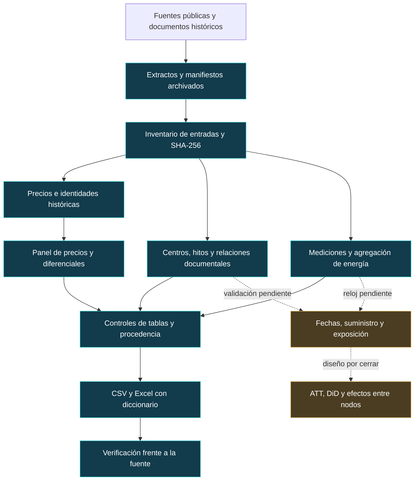

# De archivos dispersos a una base auditable

[Inicio](../README.md) · [Datos](datos.md) · [Reproducción](reproducir.md) · [Auditoría](auditoria.md) · [Decisiones](decisiones.md) · [Método](metodologia.md)

> **Estado de esta entrega:** base observada reconstruida y exportaciones verificadas, también en un entorno virtual nuevo del mismo equipo. La identificación de los tratamientos y de la exposición eléctrica sigue abierta. Esta documentación permite examinar cómo se construyó la evidencia y dónde termina lo comprobado.

| Insumos conservados | Panel horario | Identidades de barra | Hitos documentados |
|---:|---:|---:|---:|
| **90 archivos** | **178.016 × 66** | **83 históricas** | **24** |

De los 90 archivos, **41 son requeridos** por los seis pasos de reconstrucción y 49 aportan soporte. El inventario también registra **20 originales opcionales no incluidos**. Las 83 identidades de barra no representan 83 centros de datos; los 24 hitos no equivalen a 24 entradas ni a 24 tratamientos. Los conteos se sustentan en el [inventario](../SOCHER_2026_dataset/documentacion/inventario_insumos_repositorio.json) y el [control integral](../SOCHER_2026_dataset/controles/verificacion_integral.json).

## Un modelo de procedencia para este caso

Se adopta una **adaptación documental de W3C PROV-DM**: las entidades son archivos o resultados; las actividades son operaciones que utilizan y generan entidades; los agentes identifican a quienes intervienen o asumen responsabilidad. Las relaciones de uso, generación y derivación permiten seguir el origen de un resultado. Esta distinción procede del [modelo PROV-DM de W3C](https://www.w3.org/TR/prov-dm/).

La aplicación concreta siguiente es propia del proyecto. No es una teoría económica nueva, una certificación de conformidad PROV ni una serialización RDF/PROV-O ya implementada. Organiza las evidencias existentes para que un tercero pueda revisar cada transformación.

| Componente | Aplicación en este proyecto | Evidencia que lo identifica |
|---|---|---|
| Entidad de entrada | Extracto de precios, mediciones, registro de candidatos, documento eléctrico | Ruta relativa, tamaño, SHA-256, fuente y condición de archivado |
| Actividad | Homologar, agregar, calcular un diferencial, exportar, comprobar | Programa y su versión, entradas, entorno, registro de ejecución y resultado |
| Entidad de salida | Tabla, exportación, diccionario o informe de control | Nombre, claves, dimensiones, huella y reglas de validación |
| Agente y responsabilidad | Equipo investigador que decide y revisa; programa que ejecuta una transformación | Autoría del proyecto y responsable explícito de cada futura adjudicación; no se infiere del nombre del archivo |
| Derivación | Un valor del panel procede de un extracto y de una regla determinada | Identificadores y localizadores de origen, programa y control de equivalencia |
| Revisión | Una regla o asignación cambia al aparecer evidencia adicional | Registro de decisión, motivo, versión anterior y archivos afectados |

La unidad mínima de auditoría que se propone para las próximas ejecuciones es:

```text
entrada identificada
    → operación + versión del programa + entorno
    → resultado identificado + prueba + decisión de revisión
```

Las huellas muestran identidad de archivos; la prueba de contenido muestra qué propiedades se conservaron. Ninguna de las dos convierte una fecha administrativa en una intervención causal. Los responsables y motivos que no constan en los antecedentes deben registrarse como pendientes, sin reconstruirlos por suposición.

## Recorrido de la evidencia



Las flechas continuas resumen transformaciones documentadas; las discontinuas indican trabajo pendiente. La recuperación inicial está distribuida en antecedentes v2, v3, v4 y v6. La reproducción de este paquete empieza en los extractos archivados: no vuelve a descargar ni extraer todos los originales nacionales.

| Etapa | Problema que resuelve | Operación documentada | Evidencia local |
|---|---|---|---|
| 1. Delimitar insumos | El trabajo estaba distribuido entre carpetas y formatos | Declarar qué se requiere, qué se conserva como soporte y qué original no está incluido | [Inventario de insumos](../SOCHER_2026_dataset/documentacion/inventario_insumos_repositorio.json) y [verificador](../scripts/verificar_insumos.py) |
| 2. Preservar identidad | Un nombre semejante o un código de otro período puede producir un enlace incorrecto | Conservar identidad histórica, homologación y localizador de origen | [Constructor de precios](../SOCHER_2026_dataset/scripts/construir_panel_precios.py) y [control de construcción](../SOCHER_2026_dataset/controles/construccion_panel_precios.json) |
| 3. Construir resultados | Unir referencias puede duplicar filas o comparar períodos distintos | Restar Quillota 110/220 kV en la misma etiqueta publicada y verificar claves | [Control integral](../SOCHER_2026_dataset/controles/verificacion_integral.json) |
| 4. Separar hechos y tratamientos | Solicitud, energización, ampliación y primer consumo no son el mismo evento | Mantener 24 hitos, 17 relaciones y sus límites sin asignar cohortes | [Registro de eventos](../SOCHER_2026_dataset/documentacion/Eventos_relaciones_y_red.md) y [comprobación documental](../SOCHER_2026_dataset/documentacion/verificacion_eventos_relaciones.json) |
| 5. Conciliar mediciones | Energía, potencia, polaridad y reloj requieren reglas diferentes | Preservar 67.384 lecturas y agregar HT1+HT2 en 7.319 bloques de cuatro etiquetas | [Reglas de mediciones](../SOCHER_2026_dataset/documentacion/Mediciones_y_reloj.md) y [control de mediciones](../SOCHER_2026_dataset/controles/verificacion_mediciones.json) |
| 6. Comprobar equivalencia | Un archivo que abre correctamente puede haber perdido valores o claves | Contrastar precios, diferenciales, energía, nulos y referencias entre tablas | [Control integral](../SOCHER_2026_dataset/controles/verificacion_integral.json) y [contrato de doce tablas](../contracts/baseline_dataset.json) |
| 7. Entregar para revisión | La representación tabular debe ser utilizable fuera de Python | Exportar el panel completo y su diccionario; verificar contenido y estructura | [Control Excel/CSV](../SOCHER_2026_dataset/controles/verificacion_exportacion_excel_csv.json) |
| 8. Hacer portable | Rutas del equipo original y resultados mezclados dificultan repetir el trabajo | Normalizar raíces conocidas, parametrizar salidas e instalar un entorno virtual nuevo para ejecutar la secuencia completa en una carpeta independiente | [Ejecutor](../scripts/reproducir.py), [guía de reproducción](reproducir.md) y [auditoría del entorno nuevo](auditoria.md) |

Esta es una reconstrucción del proceso a partir de archivos y controles conservados. No es una cronología completa de todas las sesiones; no atribuye horas de trabajo ni cantidades de intentos no documentadas.

## Dificultades que cambian la interpretación

| Dificultad real | Riesgo para el artículo | Respuesta aplicada o pendiente | Evidencia |
|---|---|---|---|
| Homologaciones de diferente certeza | Tratar como idénticos nodos cuya continuidad no está acreditada | Mantener 137.096 filas con homologación mensual exacta y 40.920 con enlace provisional de mayo; disponer de filtros de calidad | [Registro de construcción previo](../SOCHER_2026_dataset/documentacion/Reproducibilidad_y_plan_GitHub.md) |
| Marcas de revisión del publicador | Interpretar registros observados como precios definitivos sin distinguir su estado | Conservar 12.581 filas marcadas y excluirlas de la regla estricta; cada referencia debe cumplir la misma regla | [Control de precios](../SOCHER_2026_dataset/controles/construccion_panel_precios.json) y [programa](../SOCHER_2026_dataset/scripts/construir_panel_precios.py) |
| Meses ausentes y ceros observados | Confundir falta de observaciones con actividad nula | No imputar precios de meses ausentes; diferenciar ausencia de HT1/HT2 en enero/abril de 1.440 horas de cero medido | [Mediciones y reloj](../SOCHER_2026_dataset/documentacion/Mediciones_y_reloj.md) |
| Hora 25 y sentido temporal del intervalo | Desplazar la carga o emparejarla con el precio equivocado | Preservar etiquetas; dejar pendiente UTC en precios y mantener deshabilitado el enlace precio–carga | [Mediciones y reloj](../SOCHER_2026_dataset/documentacion/Mediciones_y_reloj.md) |
| Campus con fases y varios equipos | Multiplicar artificialmente intervenciones independientes o consumo | Agrupar identidades sin adjudicar independencia; excluir HT3 del agregado hasta resolver polaridad y H1–H4 por su función de tránsito | [Eventos](../SOCHER_2026_dataset/documentacion/Eventos_relaciones_y_red.md) y [mediciones](../SOCHER_2026_dataset/documentacion/Mediciones_y_reloj.md) |
| Conexiones de diferentes fechas | Usar un mapa documental como red operativa en cualquier año | Conservar vigencia desconocida y pesos de exposición nulos | [Registro de red](../SOCHER_2026_dataset/documentacion/Eventos_relaciones_y_red.md) |
| Exportación de un libro grande | Agotar memoria al guardar o entregar un archivo incompleto | El registro previo documenta fallo de guardado con Artifact Tool y entrega final mediante escritura secuencial con openpyxl | [Registro del incidente](../SOCHER_2026_dataset/documentacion/Reproducibilidad_y_plan_GitHub.md) y [validación final](../SOCHER_2026_dataset/controles/verificacion_exportacion_excel_csv.json) |
| Rutas heredadas del equipo de origen | Romper las dependencias al mover el proyecto | Resolver raíces conocidas dentro del paquete y separar la carpeta de exportación | [Constructor documental](../SOCHER_2026_dataset/scripts/construir_eventos_relaciones.py) y [ejecutor portable](../scripts/reproducir.py) |

El incidente de memoria consta en el registro narrativo previo; esta guía no añade un tiempo, tamaño de memoria ni registro técnico de fallo que no esté archivado. La evidencia cuantitativa de la entrega es su comprobación final.

## Criterios para aceptar una ejecución

| Criterio | Evidencia de esta entrega | Alcance de la conclusión |
|---|---|---|
| Integridad de entradas | Inventario con tamaño y SHA-256; comprobador de 90 archivos | Se puede detectar si cambió una entrada archivada; no verifica originales ausentes |
| Claves y dimensiones | 178.016 identificadores del panel, 66 variables y contrato de doce tablas | Las uniones y salidas cumplen el contrato de esta versión |
| Equivalencia de precios | Error máximo frente al extracto v6: 0 | La transformación conserva los precios de ese extracto |
| Conservación de energía | Diferencia agregada de aproximadamente 9,31 × 10⁻¹⁰ kWh | La agregación concuerda numéricamente con sus entradas; no es una medición externa |
| Exportación fiel | 178.016 filas comparadas en CSV y Excel; máximo error Excel 5,68 × 10⁻¹⁴ con tolerancia 10⁻¹⁰; CSV reconstruido con SHA-256 idéntico al original | Las exportaciones verificadas conservan el panel y sus vacíos; la huella distinta del contenedor Excel se evalúa mediante controles de contenido y estructura |
| Prudencia de asignación | Cero filas elegibles para estimación causal y campos pendientes nulos | El archivo no adjudica tratamientos sin cerrar la evidencia |
| Reconstrucción portable | Entorno virtual nuevo sin paquetes del sistema; once pasos de reconstrucción, contrato y exportación completados en macOS ARM64 | Prueba local y ejecución adicional en Linux documentadas; revisión por otro investigador y adquisición completa pendientes |

Los resultados de la base están en el [control integral](../SOCHER_2026_dataset/controles/verificacion_integral.json). La [auditoría del entorno nuevo](auditoria.md) enlaza su instalación, contrato y [verificación completa de CSV y Excel](evidencia/2026-09-25/verificacion_exportacion_excel_csv.json). Su [registro de once pasos](evidencia/2026-09-25/registro_reproduccion.json) documenta 219,53 segundos de reconstrucción y exportación; esta duración excluye instalación y trabajo humano previo. La prueba local se hizo en el mismo equipo macOS ARM64. Una [ejecución adicional en GitHub Actions sobre Linux](auditoria.md#reproducción-remota-en-github-actions) completó la misma reconstrucción y exportación, con sus propios registros. No se ha probado Windows. Cada ejecución nueva debe conservar su propio registro; el informe de una entrega anterior no prueba que esa ejecución nueva haya ocurrido.

## Qué aporta al artículo

El proceso permite presentar una sección de datos verificable y un apéndice que explique selección, homologación, calidad, medición y límites. Su dificultad se demuestra mediante problemas concretos, decisiones y controles enlazados. El aporte económico deberá provenir de una pregunta identificable y resultados defendibles: todavía no se han estimado efectos causales sobre esta base.

La siguiente etapa está descrita en el [registro de decisiones](decisiones.md) y en el [contrato para estimación](../SOCHER_2026_dataset/documentacion/Contrato_para_estimacion.md).
